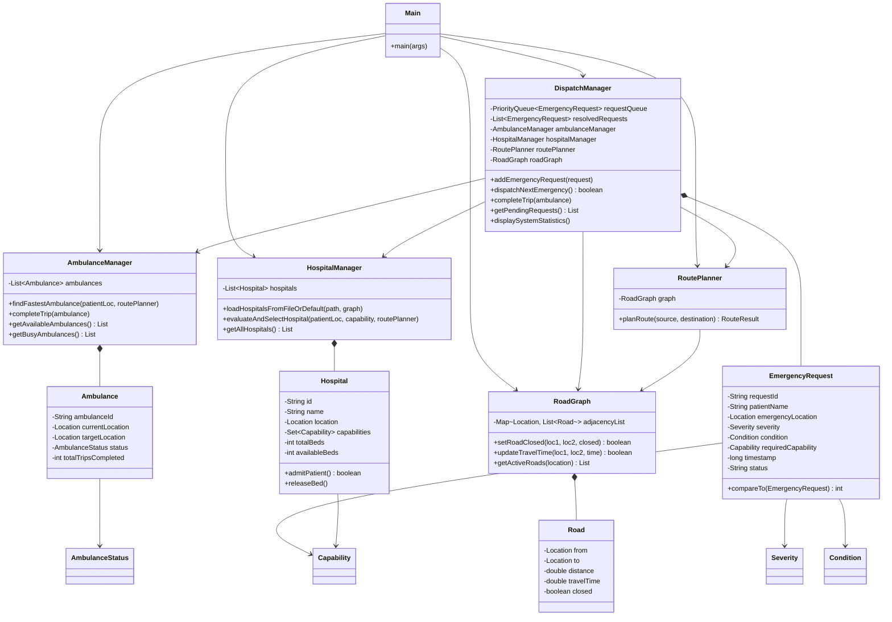

# Frontend Requirements & Java Backend Analysis Report

**Project Name:** Nalam Nagar Emergency Ambulance Dispatch & Route Optimization System  
**Document Target:** Comprehensive Specification for HTML/CSS Frontend Development & Backend Integration  
**File Location:** `FRONTEND_REQUIREMENTS.md`  
**Generated Date:** October 2026  
**Analyzed Source Root:** `e:/wbb/src`  

---

## 1. Project Overview

### 1.1 Purpose of the Project
The **Nalam Nagar Emergency Ambulance Dispatch & Route Optimization System** is a mission-critical Java application engineered to modernize emergency medical response coordination in a simulated town network ("Nalam Nagar"). 

In conventional emergency response centers, manual triage leads to first-come-first-served queueing (causing life-threatening delays for high-severity calls), ambulance allocation based on static geographic distance rather than live travel time, and dispatching patients to hospitals that lack necessary specialized units (e.g., Burn Units, Cath Labs) or have zero available beds.

This system solves these issues through an algorithmic pipeline:
1. **Intelligent Triage & Queueing:** Prioritizes patient intake using a min-heap Priority Queue ordered primarily by clinical severity (`CRITICAL` > `SERIOUS` > `MINOR`) and secondarily by call timestamp (FIFO tie-breaking).
2. **Capability & Bed-Matching:** Filters hospitals by required medical capabilities (`BURN_UNIT`, `CARDIAC_CARE`, `TRAUMA_CENTRE`, `PEDIATRIC_ICU`, `STROKE_UNIT`, `ICU`, `GENERAL_WARD`) and verified bed capacity.
3. **Shortest Travel-Time Pathfinding:** Uses **Dijkstra's Algorithm** over a directed/bidirectional weighted road network where edge weights represent travel time in minutes.
4. **Two-Leg Look-Ahead Dispatch:** Evaluates total mission ETA ($\text{Ambulance} \to \text{Patient} + \text{Patient} \to \text{Hospital}$) before dispatching.
5. **Dynamic Traffic & Incident Adaptation:** Dynamically updates road traversal times (simulating traffic congestion) and handles road closures (accidents/construction).
6. **Explainable Decision Telemetry:** Logs why specific ambulances and hospitals were chosen or rejected.

---

### 1.2 Main Features and Functionality
- **Interactive Emergency Call Intake:** Captures caller/patient name, location zone, condition, triage severity, and recommended hospital capability.
- **Priority Queue Visualization:** Inspects pending calls sorted strictly by medical priority.
- **Automated Algorithmic Dispatch:** Dequeues the top-priority request, matches the nearest suitable hospital with free beds, identifies the fastest reachable available ambulance, reserves the bed, and marks the ambulance as busy.
- **Hospital Registry & Bed Management:** Displays hospital locations, specialized units, total beds, and live available beds.
- **Ambulance Fleet Tracking:** Monitors each vehicle's identifier, home/current station, status (`AVAILABLE`, `EN_ROUTE_PATIENT`, `EN_ROUTE_HOSPITAL`, `BUSY`), destination, and completed trip counter.
- **Dynamic Road & Traffic Management:** Allows operators to view the road network, toggle road closures, and update road travel times in minutes.
- **Trip Completion Lifecycle:** Re-stations an ambulance at the admitting hospital upon arrival, admits the patient, increments vehicle trip counters, and sets the vehicle status back to `AVAILABLE`.
- **Pre-Seeded Batch Test Scenarios:** Ingests 15 diverse emergency cases into the queue to test priority sorting and dispatch logic.
- **Performance & Occupancy Analytics:** Displays queue size, completed resolution metrics, fleet busy percentages, and hospital bed occupancy percentages.

---

### 1.3 Technologies and Libraries Used
- **Language / Runtime:** Java (JDK 17+ / JDK 25 compliant syntax such as enhanced `switch` expressions and records/enums).
- **External Dependencies:** **None** (Zero third-party libraries).
- **Standard Java Libraries Used:**
  - `java.util.*`: `PriorityQueue`, `HashMap`, `ArrayList`, `HashSet`, `List`, `Map`, `Set`, `Collections`, `Comparator`, `Objects`, `Scanner`.
  - `java.time.*`: `Instant`, `ZoneId`, `format.DateTimeFormatter` (timestamp formatting).
  - `java.io.*`: `BufferedReader`, `File`, `FileReader`, `IOException` (loading `hospitals.txt`).
- **Data Persistence:** In-memory state with file-based initialization (`hospitals.txt` in project root).
- **User Interface in Existing Project:** Interactive Command-Line Interface (`Scanner(System.in)` and formatted `System.out.printf`).

---

## 2. Code Structure

### 2.1 Directory & File Layout
```
e:/wbb/
├── .classpath                          # Eclipse / VS Code classpath configuration
├── .project                            # Eclipse / VS Code project metadata
├── hospitals.txt                       # CSV hospital database (IDs, names, locations, capabilities, beds)
├── project_documentation.md            # Extensive system architecture and algorithm documentation
├── bin/                                # Compiled Java bytecode classes (.class)
└── src/
    ├── Main.java                       # Main entry point & interactive console UI
    ├── algorithm/
    │   └── RoutePlanner.java           # Dijkstra shortest path calculation
    ├── graph/
    │   └── RoadGraph.java              # Adjacency list road network graph
    ├── model/
    │   ├── Ambulance.java              # Emergency response vehicle entity
    │   ├── AmbulanceStatus.java        # Vehicle status enum (AVAILABLE, EN_ROUTE_*, BUSY)
    │   ├── Capability.java             # Hospital medical capability enum
    │   ├── Condition.java              # Patient clinical condition enum
    │   ├── EmergencyRequest.java       # Emergency request model (implements Comparable)
    │   ├── Hospital.java               # Medical facility entity with bed tracking
    │   ├── Location.java               # Graph vertex representing a town zone
    │   ├── Road.java                   # Directed graph edge (distance, travel time, closed)
    │   ├── RouteResult.java            # Pathfinding response wrapper (path, distance, time, reachable)
    │   └── Severity.java               # Triage severity enum (CRITICAL, SERIOUS, MINOR)
    └── service/
        ├── AmbulanceManager.java       # Fleet management & fastest ambulance evaluation
        ├── DataInitializer.java        # Network, fleet, and test scenario seeding
        ├── DispatchManager.java        # Central orchestrator coordinating dispatch workflows
        └── HospitalManager.java        # Hospital catalog loader & capability matching
```

---

### 2.2 Main Java Class and Entry Point
- **File:** `src/Main.java`
- **Class:** `Main`
- **Method:** `public static void main(String[] args)`
- **Initialization Lifecycle:**
  1. Instantiates `RoadGraph roadGraph = new RoadGraph()`.
  2. Calls `DataInitializer.initializeNetwork(roadGraph)` to construct 12 zones and 16 bidirectional road connections.
  3. Instantiates `RoutePlanner routePlanner = new RoutePlanner(roadGraph)`.
  4. Instantiates `HospitalManager hospitalManager = new HospitalManager()` and loads hospitals via `hospitalManager.loadHospitalsFromFileOrDefault("hospitals.txt", roadGraph)`.
  5. Instantiates `AmbulanceManager ambulanceManager = new AmbulanceManager()` and calls `DataInitializer.initializeAmbulances(ambulanceManager, roadGraph)` (5 ambulances).
  6. Instantiates `DispatchManager dispatchManager = new DispatchManager(ambulanceManager, hospitalManager, routePlanner, roadGraph)`.
  7. Runs a console `while(running)` loop evaluating operator choices `1` to `10`.

---

### 2.3 Roles of Important Classes

| Class Path | Package | Role & Responsibility |
|:---|:---|:---|
| `Main.java` | default | Interactive console driver, menus, user input reading, and workflow triggering. |
| `algorithm/RoutePlanner.java` | `algorithm` | Implements **Dijkstra's Algorithm** with a binary heap (`PriorityQueue<NodeTime>`). Finds minimum travel-time paths while ignoring closed roads. |
| `graph/RoadGraph.java` | `graph` | Weighted adjacency-list graph representing the town. Maintains locations and road segments, supports closures and dynamic travel time updates. |
| `model/Location.java` | `model` | Represents a geographical vertex/zone (`id`, `name`, `latitude`, `longitude`). |
| `model/Road.java` | `model` | Represents a directed road edge (`from`, `to`, `distance` in km, `travelTime` in mins, `closed` boolean). |
| `model/RouteResult.java` | `model` | Value object containing the computed path (`List<Location>`), `totalDistance`, `totalTime`, and `reachable` boolean flag. |
| `model/Severity.java` | `model` | Enum with 3 triage levels: `CRITICAL` (0), `SERIOUS` (1), `MINOR` (2). |
| `model/Condition.java` | `model` | Enum of 8 emergency conditions with display names, default capability requirements, and default severity levels. |
| `model/Capability.java` | `model` | Enum of 7 medical unit types (e.g. `BURN_UNIT`, `CARDIAC_CARE`, `ICU`). |
| `model/AmbulanceStatus.java` | `model` | Enum defining vehicle states: `AVAILABLE`, `EN_ROUTE_PATIENT`, `EN_ROUTE_HOSPITAL`, `BUSY`. |
| `model/Ambulance.java` | `model` | Ambulance fleet model tracking current location, target destination, status, assigned hospital, assigned request, and trip counter. |
| `model/Hospital.java` | `model` | Hospital entity with capability sets, `totalBeds`, and thread-safe `admitPatient()` / `releaseBed()` methods. |
| `model/EmergencyRequest.java` | `model` | Triage request model implementing `Comparable<EmergencyRequest>` for automatic priority queue sorting by Severity then Timestamp. |
| `service/AmbulanceManager.java` | `service` | Tracks ambulance list, filters by availability, iterates through available vehicles to calculate Dijkstra ETA, and selects the fastest one. |
| `service/HospitalManager.java` | `service` | Manages hospital catalog, parses `hospitals.txt`, evaluates matching hospitals with required capabilities and available beds, and picks the nearest by travel time. |
| `service/DispatchManager.java` | `service` | Core system coordinator; maintains `PriorityQueue<EmergencyRequest>` and `List<EmergencyRequest> resolvedRequests`, performs two-leg dispatch, reserves hospital beds, and compiles system metrics. |
| `service/DataInitializer.java` | `service` | Static helper seeding 12 town zones, 16 road edges, 5 ambulances, and 15 realistic emergency test cases. |

---

### 2.4 Class Relationships & Architecture Diagram



---

## 3. Features and Functionalities

The application exposes 10 distinct features via its control loop. Here is an exhaustive breakdown of every feature's inputs, logic, outputs, and validation rules:

### Feature 1: Record New Emergency Call (Interactive Triage)
- **Code Reference:** `Main.java` (`createEmergencyCall()`), `DispatchManager.java` (`addEmergencyRequest()`)
- **Required Inputs:**
  1. `patientName` (String): Name of patient or caller.
  2. `emergencyLocation` (Location selection): Chosen from the 12 active town zones (`1` to `locationList.size()`).
  3. `condition` (Condition selection): Chosen from 8 predefined conditions (`1` to `Condition.values().length`).
  4. `severityDecision` (Option 1 or 2):
     - `1`: Accept condition recommended severity.
     - `2`: Manual override (`1` = `CRITICAL`, `2` = `SERIOUS`, `3` = `MINOR`).
  5. `dispatchNowPrompt` (String, "y" / "n"): Option to trigger immediate dispatch upon intake.
- **Processing Logic:**
  1. Auto-generates ID formatted as `"REQ-" + requestCounter++` (starts at `REQ-101`).
  2. Maps condition to its default required capability via `condition.getDefaultRequiredCapability()`.
  3. Instantiates `EmergencyRequest` with current system timestamp.
  4. Adds request to `requestQueue` (`PriorityQueue`). The PriorityQueue automatically positions it using `EmergencyRequest.compareTo`:
     - Severity ordinal comparison: `CRITICAL (0) < SERIOUS (1) < MINOR (2)`.
     - Timestamp comparison if severity matches (earlier timestamp comes first).
  5. If immediate dispatch is confirmed (`dispatchNow == 'y'`), calls `dispatchManager.dispatchNextEmergency()`.
- **Expected Output:**
  - Confirmation card/box displaying: Request ID, Patient Name, Zone, Condition, Triage Severity with Priority Rank, Required Facility, Intake Timestamp, and Queue Position.
- **Validations & Error Handling:**
  - Patient name cannot be blank or empty (loops until non-empty input is received).
  - Zone selection must be within range `1` to `12`.
  - Condition selection must be within range `1` to `8`.
  - Severity override must be within range `1` to `3`.
  - Numeric parse errors handled via `readIntInput()` with prompt repetition.

---

### Feature 2: View Pending Emergency Queue
- **Code Reference:** `Main.java` (`viewPendingEmergencyQueue()`), `DispatchManager.java` (`getPendingRequests()`)
- **Required Inputs:** None (read-only query).
- **Processing Logic:**
  - Clones the PriorityQueue: `new PriorityQueue<>(requestQueue)`.
  - Iteratively polls requests to obtain an ordered `List<EmergencyRequest>` without destroying the underlying queue.
- **Expected Output:**
  - Formatted table showing: Queue Position (`1, 2, ...`), Request ID (`REQ-xxx`), Patient Name, Severity badge, Emergency Zone, Condition display name, and Required Medical Facility.
  - Empty state message if the queue contains 0 items: `"No emergency calls are currently pending in the queue."`
- **Validations & Error Handling:**
  - Null-safe fallback: checks if list is empty before rendering table headers.

---

### Feature 3: Dispatch Highest Priority Emergency
- **Code Reference:** `DispatchManager.java` (`dispatchNextEmergency()`), `HospitalManager.java` (`evaluateAndSelectHospital()`), `AmbulanceManager.java` (`findFastestAmbulance()`)
- **Required Inputs:** None (operates on the head element of `requestQueue`).
- **Processing Logic:**
  1. **Step 1 - Inspect Head:** Checks `requestQueue.peek()`. If empty, halts.
  2. **Step 2 - Hospital Matching:**
     - Iterates through all hospitals.
     - Filters out hospitals lacking `requiredCapability` (Logs: `[NO UNIT]`).
     - Filters out hospitals with `availableBeds <= 0` (Logs: `[FULL]`).
     - Runs Dijkstra (`RoutePlanner.planRoute(patientLoc, hospitalLoc)`) on surviving hospitals.
     - Filters out unreachable hospitals due to road closures (Logs: `[BLOCKED]`).
     - Selects hospital with minimum Dijkstra travel time.
  3. **Step 3 - Ambulance Matching:**
     - Iterates through all available ambulances (`status == AmbulanceStatus.AVAILABLE`).
     - Runs Dijkstra (`RoutePlanner.planRoute(ambLoc, patientLoc)`).
     - Filters out unreachable ambulances (Logs: `[BLOCKED]`).
     - Selects ambulance with minimum response travel time.
  4. **Step 4 - Execution & State Mutation:**
     - If both selections succeed, dequeues request via `requestQueue.poll()`.
     - Decrements hospital bed: `chosenHospital.admitPatient()`.
     - Updates ambulance: `status = AmbulanceStatus.BUSY`, `targetLocation = hospital.getLocation()`, `assignedHospital = chosenHospital`, `assignedRequest = request`.
     - Updates request: `status = "DISPATCHED"`, `assignedAmbulance = chosenAmbulance`, `assignedHospital = chosenHospital`.
  5. **Step 5 - Look-Ahead ETA Calculation:**
     - $\text{Total Look-Ahead ETA} = \text{Leg 1 Time} (\text{Amb} \to \text{Pt}) + \text{Leg 2 Time} (\text{Pt} \to \text{Hosp})$.
- **Expected Output:**
  - Detailed telemetry breakdown including Leg 1 path and ETA, Leg 2 path and ETA, Total Look-Ahead ETA, Bed reserved status, and vehicle destination.
- **Validations & Error Handling:**
  - If queue is empty: Displays warning message `"[!] No pending emergency requests in queue."`
  - If no eligible hospital exists with beds/capabilities: Request **remains in the queue** at priority 1, dispatch halts with warning `"[!] DISPATCH HALTED: No hospital currently available with required facility and beds."`
  - If all ambulances are busy or blocked: Request **remains in the queue**, dispatch halts with warning `"[!] DISPATCH UNAVAILABLE (FLEET BUSY): All ambulances are currently busy or blocked."`

---

### Feature 4: View Hospital Capacities & Medical Units
- **Code Reference:** `HospitalManager.java` (`displayHospitals()`, `getAllHospitals()`)
- **Required Inputs:** None (read-only query).
- **Processing Logic:**
  - Iterates over `hospitals` collection.
  - Calculates bed ratio: `availableBeds` / `totalBeds`.
  - Formats set of capabilities into a comma-delimited string.
- **Expected Output:**
  - Table showing: Hospital ID (`H1`-`H5`), Hospital Name, Zone Location, Available/Total Beds (`e.g., 12/25`), and List of Specialties.
- **Validations & Error Handling:**
  - Thread-safe bed counts via synchronized getters.

---

### Feature 5: View Ambulance Fleet Status
- **Code Reference:** `AmbulanceManager.java` (`displayFleet()`, `getAllAmbulances()`)
- **Required Inputs:** None (read-only query).
- **Processing Logic:**
  - Iterates over `ambulances` collection.
  - Reads `ambulanceId`, `currentLocation.getName()`, `status.getDescription()`, `targetLocation.getName()` (or `"-"`), and `totalTripsCompleted`.
- **Expected Output:**
  - Table showing: Vehicle ID (`AMB-1` to `AMB-5`), Current Station Zone, Live Status (`Available`, `Busy on Call`, etc.), Destination/Target Hospital, and Completed Trips count.

---

### Feature 6: Road Network & Dynamic Traffic Management
- **Code Reference:** `RoadGraph.java` (`displayGraph()`, `setRoadClosed()`, `updateTravelTime()`), `Main.java` (`handleTrafficAndRoadConditions()`)
- **Sub-Actions:**
  1. **View Road Network Map:** Lists all 12 zones and their outbound edges with distance (km), current travel time (min), and status (`[OPEN]` vs `[CLOSED - NO PASSAGE]`).
  2. **Report Road Closure:**
     - Inputs: Origin Zone ID/Index (`c1`), Destination Zone ID/Index (`c2`).
     - Logic: Calls `graph.setRoadClosed(loc1, loc2, true)` (bidirectional update).
     - Result: Edge is excluded by Dijkstra pathfinding in `RoutePlanner.getActiveRoads()`.
  3. **Reopen Road:**
     - Inputs: Origin Zone ID/Index (`c1`), Destination Zone ID/Index (`c2`).
     - Logic: Calls `graph.setRoadClosed(loc1, loc2, false)`.
     - Result: Edge becomes traversable again.
  4. **Update Road Travel Time (Traffic Delay):**
     - Inputs: Origin Zone (`c1`), Destination Zone (`c2`), New travel time in minutes (double > 0).
     - Logic: Calls `graph.updateTravelTime(loc1, loc2, newTime)`.
     - Result: Future Dijkstra shortest-path calculations adjust automatically to use or avoid this route.
- **Validations & Error Handling:**
  - Selection indices must be within location list bounds.
  - Origin cannot equal destination (`c1 == c2` rejected).
  - Validates that a direct edge exists between the two selected locations.
  - New travel time must be a strictly positive numerical value (`newTime > 0`).

---

### Feature 7: Complete Ambulance Trip & Admit Patient
- **Code Reference:** `DispatchManager.java` (`completeTrip()`), `AmbulanceManager.java` (`completeTrip()`), `Main.java` (`handleTripCompletion()`)
- **Required Inputs:**
  - Selection of an active/busy ambulance from `ambulanceManager.getBusyAmbulances()`.
- **Processing Logic:**
  1. Identifies the ambulance's assigned hospital and assigned emergency request.
  2. Updates request status to `"RESOLVED"` and moves it to `resolvedRequests` history list.
  3. Repositions the ambulance's current location to its target hospital location (`ambulance.setCurrentLocation(targetLocation)`).
  4. Clears vehicle target location, assigned request, and assigned hospital references.
  5. Sets ambulance status back to `AmbulanceStatus.AVAILABLE`.
  6. Increments vehicle trip counter (`totalTripsCompleted++`).
- **Expected Output:**
  - Mission completion report showing Ambulance ID, New Station Location, Available Status, Patient Admitted Hospital, and Total Vehicle Trips.
- **Validations & Error Handling:**
  - If no ambulances are currently busy: Displays empty state `"\nNo ambulances are currently on a mission."` and returns to menu.
  - Selection index must be within range `1` to `busyAmbulances.size()`.

---

### Feature 8: Batch Load 15 Sample Test Emergency Cases
- **Code Reference:** `DataInitializer.java` (`getSampleEmergencyRequests()`), `Main.java` (`runSampleTestScenarios()`)
- **Required Inputs:** None (one-click action).
- **Processing Logic:**
  - Instantiates 15 realistic requests spanning diverse locations, conditions, and severities:
    - 6 `CRITICAL` cases (`REQ-101`, `REQ-103`, `REQ-104`, `REQ-109`, `REQ-110`, `REQ-113`, `REQ-115`)
    - 5 `SERIOUS` cases (`REQ-105`, `REQ-106`, `REQ-107`, `REQ-111`, `REQ-114`)
    - 3 `MINOR` cases (`REQ-102`, `REQ-108`, `REQ-112`)
  - Iterates and inserts each into `dispatchManager.addEmergencyRequest(req)`.
- **Expected Output:**
  - Confirmation message: `"[OK] 15 emergency calls loaded successfully."`
  - All 15 requests are immediately triaged and queued in PriorityQueue order.

---

### Feature 9: View System Performance & Occupancy Stats
- **Code Reference:** `DispatchManager.java` (`displaySystemStatistics()`)
- **Required Inputs:** None (read-only dashboard metric query).
- **Processing Logic & Computed Metrics:**
  1. `totalRequestsProcessed`: Total calls received since launch.
  2. `requestQueue.size()`: Calls currently pending triage/dispatch.
  3. `resolvedRequests.size()`: Missions completed and patients admitted.
  4. Fleet Availability Rate: $\frac{\text{Available Ambulances}}{\text{Total Fleet}} \times 100\%$ and Busy Rate: $\frac{\text{Busy Ambulances}}{\text{Total Fleet}} \times 100\%$.
  5. Per-hospital Bed Occupancy: $\text{Occupied Beds} = \text{Total Beds} - \text{Available Beds}$, $\text{Occupancy \%} = \frac{\text{Occupied Beds}}{\text{Total Beds}} \times 100\%$.
- **Expected Output:**
  - Performance analytics panel with summary counters and a per-hospital capacity breakdown.

---

### Feature 10: Exit System
- **Code Reference:** `Main.java` (case 10 in main menu)
- **Required Inputs:** Selection `10`.
- **Processing Logic:** Sets loop sentinel `running = false`.
- **Expected Output:** Console termination message `"Exiting Nalam Nagar Emergency Dispatch System. Stay safe!"`.

---

## 4. Frontend Requirements

To transform this console application into an intuitive, modern web application using **HTML and CSS**, the following pages, components, data fields, and UI states are required.

### 4.1 Required Screens / Pages

A multi-page architecture or a single-page application (SPA) with tabbed navigation:

```
[ Navigation Bar: Nalam Nagar Emergency Dispatch Centre ]
  ├── 1. Dashboard (Overview & Analytics)
  ├── 2. Emergency Intake (Triage & Call Logging Form)
  ├── 3. Priority Queue (Live Triage Heap)
  ├── 4. Ambulance Fleet (Fleet Status & Trip Completion)
  ├── 5. Hospital Registry (Specialties & Bed Capacities)
  └── 6. Road Network & Traffic (Closures & Delay Management)
```

---

### 4.2 Detailed Screen-by-Screen Specifications

#### Screen 1: Dashboard / Overview
- **Purpose:** Central command dashboard providing immediate operational awareness to emergency operators.
- **UI Elements:**
  - **Metric Stat Cards (4 Cards in a responsive grid):**
    1. *Active Pending Queue:* Total count (large display number) with severity breakdown badges.
    2. *Ambulances Available:* e.g., `4 / 5 Ready (80%)` with a mini status indicator dot.
    3. *Total Requests Logged / Resolved:* e.g., `15 Logged | 3 Resolved`.
    4. *Average Hospital Occupancy:* Overall percentage bar.
  - **Quick Action Bar (Buttons):**
    - `[+ New Emergency Call]` (navigates to Intake)
    - `[⚡ Dispatch Next Priority Call]` (triggers primary algorithmic dispatch)
    - `[📥 Load 15 Test Cases]` (triggers batch load)
  - **Hospital Bed Occupancy Summary Table:**
    - Columns: Hospital Name, Zone, Available / Total Beds, Progress Bar (% Occupied), Status Badge (`Normal`, `Crowded`, `Full`).
  - **Recent Activity / Dispatch Feed:**
    - Displays last 5 actions with timestamps and severity tags.

---

#### Screen 2: Emergency Call Intake (Triage Form)
- **Purpose:** Operator interface for incoming 911/108 emergency calls.
- **UI Elements & Form Fields:**
  - **Card Container:** Form header titled `"Emergency Call Intake & Triage"`.
  - **Field 1: Caller / Patient Name**
    - HTML: `<input type="text" name="patientName" placeholder="e.g. Ramesh Kumar" required>`
    - Helper text: *"Enter full name or unidentified caller description."*
  - **Field 2: Emergency Zone / Location**
    - HTML: `<select name="emergencyLocation" required>`
    - Options (12 locations from `DataInitializer.java`):
      1. Central Hospital Junction (L1)
      2. Market Circle (L2)
      3. Residential Colony A (L3)
      4. Industrial Area (L4)
      5. College Road (L5)
      6. Town Bus Terminal (L6)
      7. Greenfield Suburb (L7)
      8. Tech Park Zone (L8)
      9. Old City Bazaar (L9)
      10. Highway Bypass Junction (L10)
      11. Riverside Gardens (L11)
      12. North Gate Hub (L12)
  - **Field 3: Reported Medical Condition**
    - HTML: `<select name="condition" required>`
    - Options (8 conditions from `Condition.java`):
      1. Severe Burn Injury (`BURN` $\to$ Recommends: Burn Unit / CRITICAL)
      2. Cardiac Arrest / Acute Coronary (`CARDIAC_ARREST` $\to$ Recommends: Cardiac Care / CRITICAL)
      3. Severe Multi-Trauma / Accident (`TRAUMA` $\to$ Recommends: Trauma Centre / CRITICAL)
      4. Acute Ischemic/Hemorrhagic Stroke (`STROKE` $\to$ Recommends: Stroke Unit / CRITICAL)
      5. Pediatric Respiratory/Crisis (`PEDIATRIC_EMERGENCY` $\to$ Recommends: Pediatric ICU / SERIOUS)
      6. Severe Respiratory Distress (`RESPIRATORY_FAILURE` $\to$ Recommends: ICU / SERIOUS)
      7. Bone Fracture / Minor Trauma (`FRACTURE` $\to$ Recommends: General Ward / SERIOUS)
      8. Acute Fever / Dehydration / Mild Pain (`GENERAL_ILLNESS` $\to$ Recommends: General Ward / MINOR)
  - **Field 4: Triage Severity Level**
    - Radio Group or Dropdown with 3 options:
      - `CRITICAL` (Immediate life-threat - Rank 1)
      - `SERIOUS` (Urgent intervention needed - Rank 2)
      - `MINOR` (Non-life-threatening - Rank 3)
    - Recommendation Badge: *"Auto-assigned based on selected condition with manual operator override option."*
  - **Field 5: Required Medical Capability**
    - Auto-selected / read-only or customizable select:
      - `BURN_UNIT`, `CARDIAC_CARE`, `TRAUMA_CENTRE`, `PEDIATRIC_ICU`, `STROKE_UNIT`, `ICU`, `GENERAL_WARD`.
  - **Action Checkbox:**
    - HTML: `<input type="checkbox" id="dispatchImmediately" name="dispatchImmediately" checked>`
    - Label: *"Immediately trigger optimal ambulance dispatch upon recording"*
  - **Buttons:**
    - Primary: `[ Submit & Enqueue Call ]` (Accent Color: Vibrant Red/Coral)
    - Secondary: `[ Reset Form ]`

---

#### Screen 3: Pending Emergency Queue
- **Purpose:** Visual representation of the Java `PriorityQueue<EmergencyRequest>`.
- **UI Elements:**
  - **Header with Live Badge:** e.g., `"Pending Emergency Queue (3 Calls Waiting)"`.
  - **Data Table:**
    - Columns:
      1. **Queue Rank** (`#1, #2, #3...`)
      2. **Request ID** (`REQ-101`)
      3. **Patient Name**
      4. **Zone / Location**
      5. **Medical Condition**
      6. **Required Facility**
      7. **Triage Severity** (Color-coded badge: Red for `CRITICAL`, Orange for `SERIOUS`, Green for `MINOR`)
      8. **Intake Time** (Formatted HH:mm:ss)
      9. **Action Button** (`[ Dispatch Unit ]` on the #1 ranked row)
  - **Empty State Container:**
    - Shown when `requestQueue` is empty.
    - Icon + Message: *"All clear! No emergency calls are currently waiting in the queue."*

---

#### Screen 4: Dispatch Result & Mission Telemetry (Modal or Output Card)
- **Purpose:** Renders the explainable decision log generated by `DispatchManager.dispatchNextEmergency()`.
- **UI Elements:**
  - **Banner:** `"Emergency Mission Dispatched: REQ-xxx"`
  - **Two-Leg Route Timeline Visual:**
    - **Leg 1: Response Phase ($\text{Ambulance} \to \text{Patient}$)**
      - Assigned Vehicle: `AMB-1` (Station: Central Hospital Junction)
      - Planned Route: `Central Hospital Junction -> Old City Bazaar -> Industrial Area`
      - Leg 1 ETA: `5.0 min (2.0 km)`
    - **Leg 2: Transport Phase ($\text{Patient} \to \text{Hospital}$)**
      - Admitting Hospital: `Apex Heart & Trauma Institute` (Industrial Area)
      - Planned Route: `Direct / 0.0 min (0.0 km)`
      - Leg 2 ETA: `10.0 min (4.0 km)`
    - **Total Mission Look-Ahead ETA:** Large callout badge, e.g., `TOTAL LOOK-AHEAD ETA: 15.0 MINUTES`.
  - **Hospital Bed Allocation Confirmation:**
    - *"Bed successfully reserved at Apex Heart & Trauma Institute. Remaining beds: 3/15."*
  - **Evaluation Telemetry Collapsible / Log:**
    - Shows rejected hospitals with exact failure reasons: `[NO UNIT]`, `[FULL]`, `[BLOCKED]`.

---

#### Screen 5: Ambulance Fleet & Active Missions
- **Purpose:** Vehicle asset tracking and trip completion handling.
- **UI Elements:**
  - **Fleet Table / Grid of Cards (5 Ambulances):**
    - Vehicle ID (`AMB-1` to `AMB-5`)
    - Current Station Zone
    - Live Status Badge:
      - `Available` (Green badge)
      - `Busy on Call` (Pulsing Red badge)
      - `En Route to Patient` (Amber badge)
      - `En Route to Hospital` (Blue badge)
    - Active Destination / Assigned Hospital
    - Trips Completed Counter
    - Action: `[ Complete Trip & Admit Patient ]` button (active only when ambulance is `BUSY`).
  - **Trip Completion Modal / Confirmation:**
    - Displays arrival at hospital, patient bed admission confirmation, and vehicle repositioning.

---

#### Screen 6: Hospital Registry & Bed Management
- **Purpose:** Overview of town medical infrastructure and bed availability.
- **UI Elements:**
  - **Hospital Cards / Table (5 Hospitals):**
    - Hospital ID & Name:
      1. `H1` - Nalam General Hospital
      2. `H2` - Apex Heart & Trauma Institute
      3. `H3` - Grace Children & Multi-Care
      4. `H4` - Sanjeevani Burn & Critical Care
      5. `H5` - Nalam Neuro & Stroke Care
    - Location Zone
    - Total Beds & Live Available Beds Counter
    - Visual Bed Occupancy Progress Bar (`<progress>` or CSS bar with width %)
    - Specialized Medical Capability Tags/Chips (e.g., `[BURN_UNIT]`, `[CARDIAC_CARE]`, `[ICU]`).

---

#### Screen 7: Road Network & Dynamic Traffic Management
- **Purpose:** Operator control for simulating live disruptions, road closures, and traffic congestion.
- **UI Elements:**
  - **Network Connections Table:**
    - Columns: Segment (e.g. `Central Hospital <-> Town Bus Terminal`), Distance (`2.5 km`), Current Travel Time (`6.0 min`), Status (`OPEN` / `CLOSED`), Actions.
  - **Control Form 1: Road Closure / Reopening Toggle**
    - Origin Zone Dropdown
    - Destination Zone Dropdown
    - Status Radio: `[ Mark Closed ]` / `[ Reopen Road ]`
    - Submit Button: `[ Update Road Status ]`
  - **Control Form 2: Dynamic Traffic Delay Adjustment**
    - Origin Zone Dropdown
    - Destination Zone Dropdown
    - Travel Time Input (Number, minutes, step="0.5")
    - Submit Button: `[ Apply Traffic Delay ]`
  - **Feedback Callout:** Confirms updated travel time for future Dijkstra calculations.

---

### 4.3 Summary of UI Elements Mapping

| Screen / Feature | UI Element Type | Java Model / Field Binding | User Action | Expected Result |
|:---|:---|:---|:---|:---|
| Emergency Intake | Text Input | `EmergencyRequest.patientName` | Types name | Validated non-empty string |
| Emergency Intake | Dropdown (`<select>`) | `Location.id`, `Location.name` | Selects 1 of 12 zones | Sets patient location |
| Emergency Intake | Dropdown (`<select>`) | `Condition` enum | Selects condition | Auto-populates severity and capability |
| Emergency Intake | Radio / Dropdown | `Severity` enum | Selects/Overrides | Changes queue priority rank |
| Emergency Intake | Submit Button | `DispatchManager.addEmergencyRequest()` | Clicks submit | Enqueues request, shows confirmation |
| Pending Queue | Data Table | `List<EmergencyRequest>` from PriorityQueue | Views list | Sorted by Priority (Critical $\to$ Minor $\to$ FIFO) |
| Pending Queue | Button on Row #1 | `DispatchManager.dispatchNextEmergency()` | Clicks "Dispatch" | Executes Dijkstra dispatch for highest priority |
| Active Fleet | Action Button | `DispatchManager.completeTrip(ambulance)` | Clicks "Complete" | Restations vehicle, admits patient, marks Available |
| Road Management | Toggle / Button | `RoadGraph.setRoadClosed(l1, l2, bool)` | Clicks toggle | Blocks/unblocks edge in Dijkstra pathfinding |
| Road Management | Number Input | `RoadGraph.updateTravelTime(l1, l2, time)` | Enters minutes | Updates road weight for future shortest path runs |
| Dashboard | Button | `DataInitializer.getSampleEmergencyRequests()` | Clicks "Load 15" | Populates PriorityQueue with 15 test cases |

---

### 4.4 Success, Error, and Empty States

| Context | Trigger / Condition | UI State & Notification Message | Visual Styling |
|:---|:---|:---|:---|
| **Intake Success** | Valid form submitted | `"Emergency Call REQ-xxx successfully recorded and placed at position #X in priority queue."` | Green alert box with checkmark icon |
| **Intake Error** | Blank name submitted | `"Error: Caller/Patient name cannot be empty."` | Red input border & validation tooltip |
| **Dispatch Success** | Hospital & Ambulance matched | `"Dispatch Executed! Ambulance AMB-X assigned. Total Look-Ahead ETA: XX.X min."` | High-visibility modal with route map |
| **Dispatch Warning** | No hospital has capability or beds | `"[ALERT] Dispatch Halted: No hospital with required facility (e.g. BURN_UNIT) has available beds. Request remains at top of queue."` | Amber warning banner with pulse effect |
| **Dispatch Warning** | All ambulances are busy/blocked | `"[ALERT] Dispatch Unavailable: All ambulances are currently busy or blocked by road closures. Request held in queue."` | Amber warning banner |
| **Dispatch Warning** | Queue is empty | `"No pending emergency calls in the queue to dispatch."` | Blue informational toast |
| **Road Update Success** | Road closed / opened / time updated | `"Road segment [Loc A <-> Loc B] successfully updated (Status / Time: XX.X min)."` | Green dismissible toast |
| **Road Update Error** | No direct road exists between zones | `"Error: No direct road segment connects the two selected locations."` | Red error alert |
| **Trip Complete Success**| Trip finalized | `"Mission Completed. Ambulance AMB-X is now AVAILABLE at [Hospital Name]. Patient admitted."` | Green confirmation card |
| **Queue Empty State** | Zero pending calls | `"Queue is empty. No emergency cases waiting for dispatch."` | Centered illustration + muted text |
| **Fleet Empty State** | Zero busy ambulances | `"No ambulances are currently on a mission."` | Disabled "Complete Trip" buttons |

---

## 5. Backend Integration

### 5.1 Current Backend Communication Architecture
- **Current State:** The existing Java application is a **standalone command-line program** with an interactive loop in `src/Main.java`.
- **Database/Persistence:** There is **no database or JDBC connection**. Hospitals are initialized from a local text file (`hospitals.txt`), while roads and ambulances are hardcoded in `src/service/DataInitializer.java`.
- **Network Interface:** There are **no HTTP endpoints, Servlets, or REST controllers** in the current repository. State is held in JVM memory during application runtime.

---

### 5.2 Required Bridge Architecture for Web Frontend
Because standard HTML and CSS cannot directly execute compiled Java bytecode (`.class` files), a bridge layer is required to connect a web browser to the Java engine:

```
+------------------------------------------+
|       WEB FRONTEND (HTML / CSS / JS)     |
|   - Browser UI, Forms, Tables, Alerts    |
+------------------------------------------+
                    |
           HTTP Requests (JSON / REST)
                    |
                    v
+------------------------------------------+
|       JAVA BACKEND REST API LAYER        |
|   (Option A: Built-in Java HttpServer)   |
|   (Option B: Spring Boot / Javalin)      |
+------------------------------------------+
                    |
           Internal Method Calls
                    |
                    v
+------------------------------------------+
|       EXISTING JAVA DOMAIN ENGINE        |
|   - DispatchManager (PriorityQueue)      |
|   - RoutePlanner (Dijkstra Algorithm)    |
|   - RoadGraph (Adjacency List)           |
|   - HospitalManager & AmbulanceManager   |
+------------------------------------------+
```

#### Recommended Architecture Options:
1. **Option A: Built-in Java Lightweight HTTP Server (Zero Dependencies, Pure JDK):**
   - Java includes `com.sun.net.httpserver.HttpServer` in the standard JDK library (`jdk.httpserver` module).
   - A single new class (e.g., `src/api/ApiServer.java`) can bind to port `8080`, serve the static `index.html` / `styles.css` files, and expose REST JSON endpoints.
   - Requires zero third-party JARs or build tools.
2. **Option B: Modern Framework (Spring Boot or Javalin):**
   - Wrap the existing service classes (`DispatchManager`, `HospitalManager`, etc.) with `@RestController` annotations.
   - Recommended if user intends to build an enterprise-scale full-stack system.
3. **Option C: Pure Static Prototype (HTML & CSS alone):**
   - Build complete HTML pages and CSS styling using sample mocked data (from `DataInitializer.java`) to establish and approve the UI design before implementing API wiring.

---

### 5.3 What Can Be Done with HTML/CSS Alone vs. What Requires JavaScript / Java

| Layer / Responsibility | HTML & CSS Alone | Requires JavaScript | Requires Java Backend |
|:---|:---:|:---:|:---:|
| Page layouts, navigation bar, grid layouts | Yes | No | No |
| Styling, typography, badges, color palettes | Yes | No | No |
| Static tables, mockup cards, form field inputs | Yes | No | No |
| Modal dialogs, collapsible accordions (using CSS `:checked` or `<details>`) | Yes | No | No |
| Form input client-side format validation | Basic (HTML5) | Advanced | No |
| Auto-filling recommended severity when condition dropdown changes | No | Yes | No |
| Submitting forms asynchronously without full page reload (AJAX/Fetch) | No | Yes | No |
| Dynamically appending new rows to the Pending Queue table | No | Yes | No |
| Min-Heap Priority Queue ordering by Severity & Timestamp | No | No | **Yes (`DispatchManager`)** |
| Dijkstra shortest-path computation with live edge weights | No | No | **Yes (`RoutePlanner`)** |
| Hospital capability filtering & thread-safe bed decrementing | No | No | **Yes (`HospitalManager`)** |
| Dynamic road closure updates & vehicle state mutation | No | No | **Yes (`RoadGraph`, `Ambulance`)** |

---

### 5.4 Proposed REST API Endpoints Specification

When the Java backend API layer is constructed, the following endpoints map 1:1 to the existing Java codebase:

| HTTP Method | API Route | Java Method Call | Request Payload (JSON) | Response Payload (JSON) |
|:---|:---|:---|:---|:---|
| `GET` | `/api/dashboard/stats` | `dispatchManager.displaySystemStatistics()` | None | `{ totalRequests, pendingCount, resolvedCount, fleetAvailable, fleetTotal, hospitals: [...] }` |
| `GET` | `/api/queue/pending` | `dispatchManager.getPendingRequests()` | None | `[ { requestId, patientName, location, severity, condition, requiredCapability, timestamp } ]` |
| `POST` | `/api/requests/intake` | `dispatchManager.addEmergencyRequest(req)` | `{ patientName, locationId, condition, severityOverride, dispatchImmediately }` | `{ success: true, requestId: "REQ-xxx", queuePosition: 2 }` |
| `POST` | `/api/dispatch/next` | `dispatchManager.dispatchNextEmergency()` | None | `{ success: true, request, ambulance, hospital, leg1Route, leg2Route, totalEta }` |
| `GET` | `/api/fleet` | `ambulanceManager.getAllAmbulances()` | None | `[ { id: "AMB-1", location: "L1", status: "AVAILABLE", trips: 3 } ]` |
| `POST` | `/api/fleet/complete-trip` | `dispatchManager.completeTrip(ambulance)` | `{ ambulanceId: "AMB-1" }` | `{ success: true, newLocation: "L2", status: "AVAILABLE" }` |
| `GET` | `/api/hospitals` | `hospitalManager.getAllHospitals()` | None | `[ { id: "H1", name: "...", location: "L1", totalBeds: 25, availableBeds: 12, capabilities: [...] } ]` |
| `GET` | `/api/roads` | `roadGraph.getAllUniqueRoads()` | None | `[ { from: "L1", to: "L6", distance: 2.5, travelTime: 6.0, closed: false } ]` |
| `POST` | `/api/roads/status` | `roadGraph.setRoadClosed(l1, l2, closed)` | `{ fromId: "L1", toId: "L6", closed: true }` | `{ success: true, road: { ... } }` |
| `POST` | `/api/roads/traffic` | `roadGraph.updateTravelTime(l1, l2, time)` | `{ fromId: "L1", toId: "L6", travelTime: 12.5 }` | `{ success: true, updatedTime: 12.5 }` |
| `POST` | `/api/scenarios/load-sample` | `DataInitializer.getSampleEmergencyRequests()` | None | `{ success: true, loadedCount: 15 }` |

---

## 6. UI Design Specification

A clean, beginner-friendly, and professional design specification tailored for emergency coordination.

### 6.1 Theme and Color Palette
Emergency dispatch dashboards require high contrast, calm readability, and distinct color codes for triage:

```css
:root {
  /* Brand / Surface Colors */
  --bg-primary: #0f172a;          /* Deep slate navy background */
  --bg-surface: #1e293b;          /* Elevated card and table container */
  --bg-surface-hover: #334155;    /* Interactive hover state */
  --border-color: #334155;        /* Subtle divider borders */
  --text-primary: #f8fafc;        /* High-contrast crisp white text */
  --text-secondary: #94a3b8;      /* Muted secondary labels */

  /* Triage Severity Accent Colors */
  --color-critical: #ef4444;      /* Vibrant emergency red (CRITICAL / High Life Threat) */
  --color-critical-bg: rgba(239, 68, 68, 0.15);
  --color-serious: #f59e0b;       /* Warning amber (SERIOUS / Urgent) */
  --color-serious-bg: rgba(245, 158, 11, 0.15);
  --color-minor: #10b981;         /* Emerald green (MINOR / Non-critical) */
  --color-minor-bg: rgba(16, 185, 129, 0.15);

  /* Functional Accents */
  --accent-cyan: #06b6d4;         /* Telemetry and route lines */
  --accent-blue: #3b82f6;         /* Primary buttons and links */
  --accent-indigo: #6366f1;       /* Hospital specialties */
}
```

---

### 6.2 Typography & Sizing
- **Font Family:** Modern system font stack or Google Font (`'Inter'`, `'Segoe UI'`, sans-serif).
- **Heading 1 (`h1`):** 28px / Semi-bold (System Title).
- **Heading 2 (`h2`):** 20px / Medium (Section Titles).
- **Body Text:** 14px / Regular (Forms, Tables, Labels).
- **Monospace Font:** `'JetBrains Mono'`, `'Consolas'`, monospace (for IDs like `REQ-101`, `AMB-1`, route paths, and ETAs).

---

### 6.3 Layout Structure

```
+-----------------------------------------------------------------------------------+
|  [Logo] NALAM NAGAR EMERGENCY DISPATCH & ROUTE OPTIMIZATION   [Status: System Ready]|
+-----------------------------------------------------------------------------------+
|  [Dashboard]  [New Intake]  [Priority Queue (3)]  [Fleet]  [Hospitals]  [Traffic]  |
+-----------------------------------------------------------------------------------+
|                                                                                   |
|  [ Stat Card 1 ]    [ Stat Card 2 ]    [ Stat Card 3 ]    [ Stat Card 4 ]         |
|  Pending Queue: 3   Fleet: 4/5 Ready   Resolved: 12       Occupancy: 64%          |
|                                                                                   |
|  +---------------------------------------+  +----------------------------------+  |
|  | LEFT SECTION (65% Width)              |  | RIGHT SECTION (35% Width)        |  |
|  | - Priority Queue Table                |  | - Hospital Capacity Breakdown    |  |
|  | - One-Click Dispatch Trigger          |  | - Quick Triage Intake Form       |  |
|  | - Decision Telemetry & Route Details  |  | - Road Closure Alerts            |  |
|  +---------------------------------------+  +----------------------------------+  |
+-----------------------------------------------------------------------------------+
```

---

### 6.4 Key UI Component Styling Guide

#### 1. Severity Badges
```css
.badge {
  display: inline-block;
  padding: 4px 10px;
  border-radius: 9999px;
  font-size: 12px;
  font-weight: 600;
  text-transform: uppercase;
}
.badge-critical {
  color: var(--color-critical);
  background-color: var(--color-critical-bg);
  border: 1px solid var(--color-critical);
}
.badge-serious {
  color: var(--color-serious);
  background-color: var(--color-serious-bg);
  border: 1px solid var(--color-serious);
}
.badge-minor {
  color: var(--color-minor);
  background-color: var(--color-minor-bg);
  border: 1px solid var(--color-minor);
}
```

#### 2. Clean Form Controls
```css
.form-group {
  margin-bottom: 16px;
  display: flex;
  flex-direction: column;
  gap: 6px;
}
.form-label {
  color: var(--text-secondary);
  font-size: 13px;
  font-weight: 500;
}
.form-input, .form-select {
  background-color: var(--bg-primary);
  border: 1px solid var(--border-color);
  color: var(--text-primary);
  padding: 10px 14px;
  border-radius: 6px;
  font-size: 14px;
}
.form-input:focus, .form-select:focus {
  outline: none;
  border-color: var(--accent-blue);
  box-shadow: 0 0 0 2px rgba(59, 130, 246, 0.25);
}
```

#### 3. Responsive Data Tables
```css
.data-table {
  width: 100%;
  border-collapse: collapse;
  text-align: left;
}
.data-table th {
  background-color: rgba(15, 23, 42, 0.6);
  color: var(--text-secondary);
  padding: 12px 16px;
  font-size: 12px;
  text-transform: uppercase;
  letter-spacing: 0.05em;
  border-bottom: 1px solid var(--border-color);
}
.data-table td {
  padding: 14px 16px;
  border-bottom: 1px solid var(--border-color);
  color: var(--text-primary);
  font-size: 14px;
}
.data-table tr:hover {
  background-color: var(--bg-surface-hover);
}
```

---

## 7. Implementation Checklist for Frontend Developer

When writing the HTML and CSS files, follow this step-by-step checklist:

- [ ] **Step 1: Setup HTML Skeleton & CSS Tokens**
  - Create `index.html` and `styles.css`.
  - Add Google Font (`Inter`), define CSS variables in `:root` (palette, spacing, shadows).
- [ ] **Step 2: Build Header & Navigation**
  - Brand title `"Nalam Nagar Emergency Ambulance Dispatch & Route Optimization"`.
  - Navigation tabs (Dashboard, Intake, Queue, Fleet, Hospitals, Traffic).
- [ ] **Step 3: Construct the Emergency Intake Form (Screen 2)**
  - Form fields matching `EmergencyRequest`: Patient Name, 12 Zone Dropdown, 8 Conditions Dropdown, Severity Radios, Immediate Dispatch checkbox.
- [ ] **Step 4: Construct the Priority Queue View (Screen 3)**
  - Table with Priority Rank, Request ID, Patient Name, Zone, Condition, Facility, Severity Badge, Timestamp, and Dispatch button.
- [ ] **Step 5: Construct the Dispatch Telemetry Modal / Card (Screen 4)**
  - Two-leg visual breakdown: Leg 1 (Ambulance $\to$ Patient), Leg 2 (Patient $\to$ Hospital), Total Look-Ahead ETA badge, and hospital bed reservation notice.
- [ ] **Step 6: Construct the Ambulance Fleet Status Table (Screen 5)**
  - Table listing all 5 ambulances (`AMB-1` through `AMB-5`) with status badges and "Complete Trip" action buttons.
- [ ] **Step 7: Construct the Hospital Registry & Bed Capacity View (Screen 6)**
  - Hospital cards with available bed progress bars and capability chips.
- [ ] **Step 8: Construct Dynamic Traffic & Road Management Controls (Screen 7)**
  - Road network table, Road closure/reopen form, and Traffic delay update input.
- [ ] **Step 9: Review Empty States & Responsiveness**
  - Add friendly empty state banners when queue has 0 items or no ambulances are busy.
  - Ensure media queries handle mobile/tablet viewport widths gracefully.

---

*Report generated directly from Java source code files in `e:/wbb/src`.*
