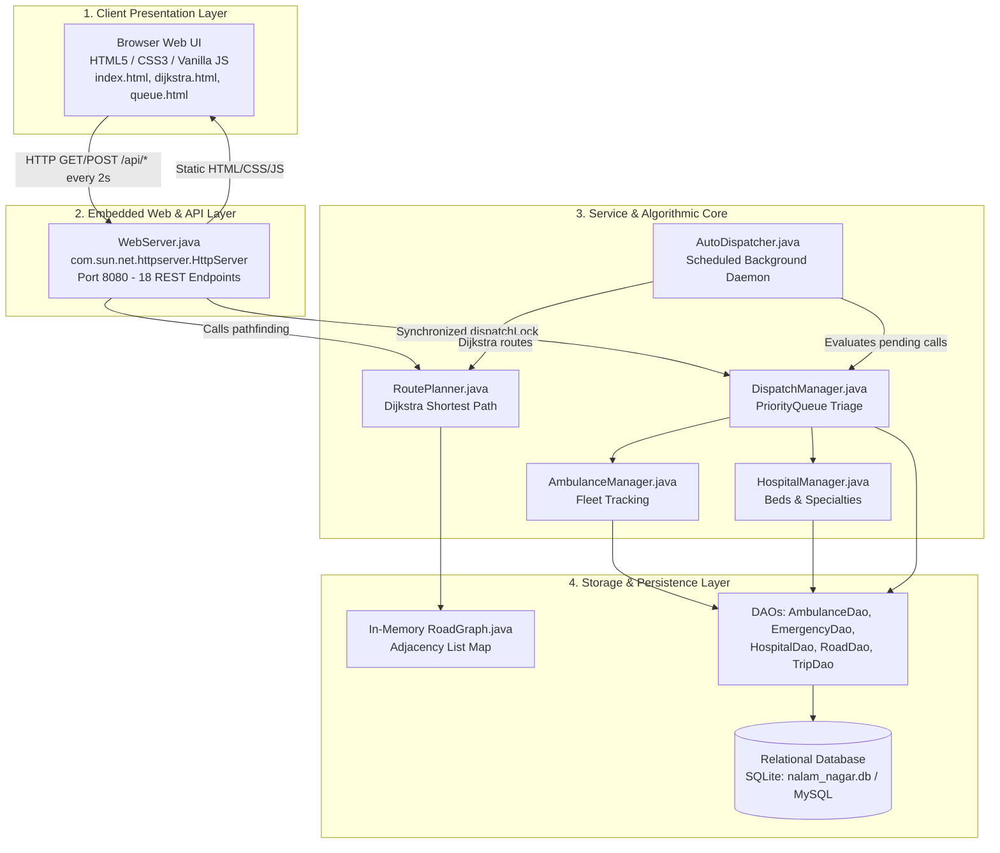
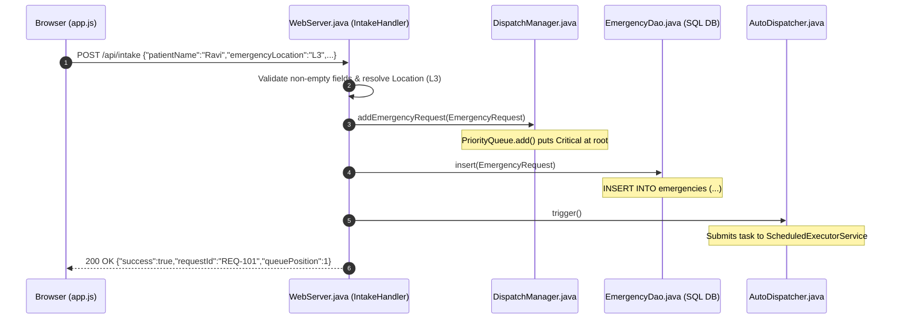
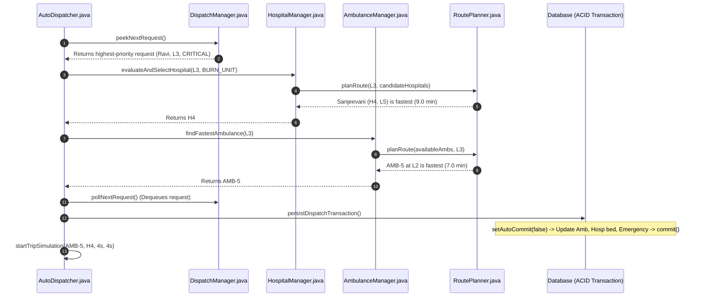
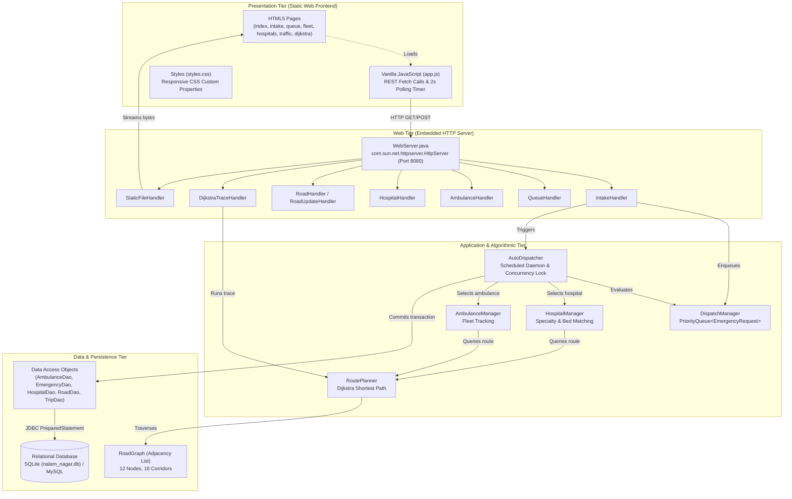
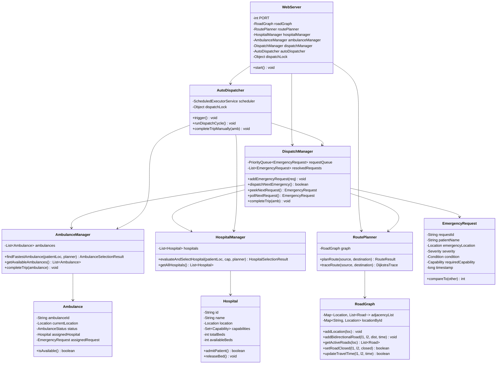
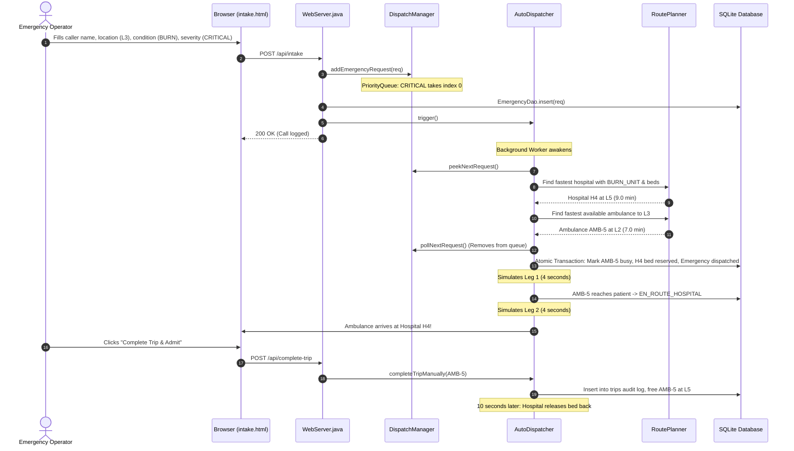
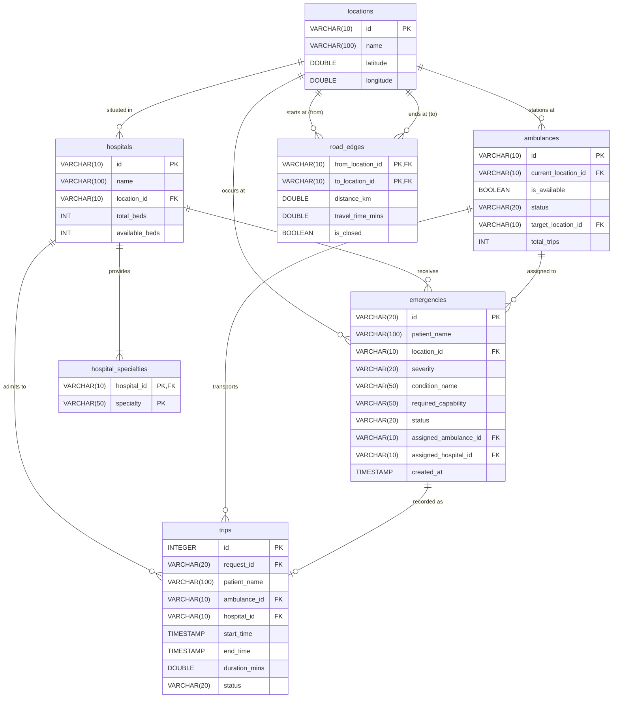
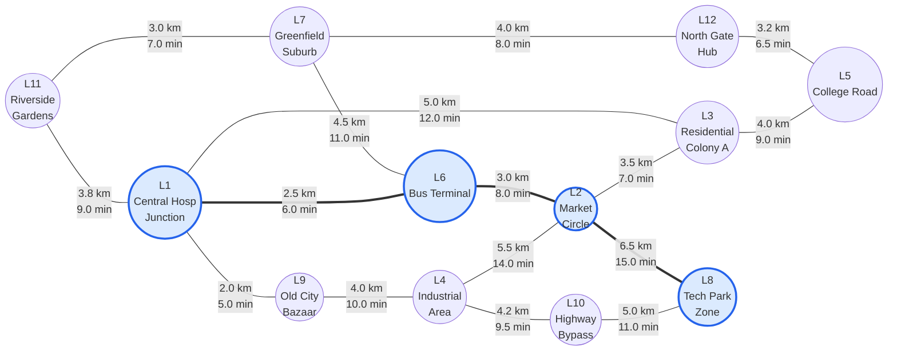

# Nalam Nagar Emergency Ambulance Dispatch & Route Optimization System
## Complete Student Study Material, Code Walkthrough, and Viva Defense Guide

> **Welcome!** This study guide is designed specifically for students who know basic Java but want to master graph algorithms, data structures, concurrency, REST APIs, and database transactions through this real-world emergency dispatch project.
> 
> Every concept starts with a **real-life story or analogy**, moves to an **intuitive explanation with numbers**, and then points directly to the **exact class and method in your code**.

---

## Table of Contents
1. [The Big Picture](#1-the-big-picture)
   - [The Problem We Solve](#11-the-problem-we-solve)
   - [Real-Life Scenario: Ravi's Emergency](#12-real-life-scenario-ravis-emergency)
   - [System Architecture (The 4 Layers)](#13-system-architecture-the-4-layers)
   - [The Complete Life of an Emergency (Timeline)](#14-the-complete-life-of-an-emergency-timeline)
2. [Concepts Explained Simply](#2-concepts-explained-simply)
   - [Concept 1: Graph Network (`RoadGraph`)](#concept-1-graph-network-roadgraph)
   - [Concept 2: Dijkstra's Algorithm (`RoutePlanner`)](#concept-2-dijkstras-algorithm-routeplanner)
   - [Concept 3: PriorityQueue Triage (`DispatchManager`)](#concept-3-priorityqueue-triage-dispatchmanager)
   - [Concept 4: Two-Leg Dispatch Logic](#concept-4-two-leg-dispatch-logic)
   - [Concept 5: REST API and JSON](#concept-5-rest-api-and-json)
   - [Concept 6: Embedded HTTP Server & Static Files (`WebServer`)](#concept-6-embedded-http-server--static-files-webserver)
   - [Concept 7: Concurrency, Thread Safety & Preemption (`AutoDispatcher`)](#concept-7-concurrency-thread-safety--preemption-autodispatcher)
   - [Concept 8: Frontend Polling & Real-Time Updates](#concept-8-frontend-polling--real-time-updates)
   - [Concept 9: Relational Database & Transactions (`Database` & DAOs)](#concept-9-relational-database--transactions-database--daos)
3. [Deep Code Walkthroughs](#3-deep-code-walkthroughs)
   - [`RoadGraph.java`](#roadgraphjava)
   - [`RoutePlanner.java`](#routeplannerjava)
   - [`EmergencyRequest.java`](#emergencyrequestjava)
   - [`DispatchManager.java`](#dispatchmanagerjava)
   - [`AmbulanceManager.java`](#ambulancemanagerjava)
   - [`HospitalManager.java`](#hospitalmanagerjava)
   - [`AutoDispatcher.java`](#autodispatcherjava)
   - [`Database.java` & DAOs](#databasejava--daos)
   - [`WebServer.java`](#webserverjava)
   - [End-to-End Flow Traces](#end-to-end-flow-traces)
4. [Visual Architecture & Flowcharts](#4-visual-architecture--flowcharts)
   - [System Architecture Diagram](#system-architecture-diagram)
   - [UML Class Relationships](#uml-class-relationships)
   - [End-to-End Emergency Lifecycle Sequence](#end-to-end-emergency-lifecycle-sequence)
   - [Relational Database Schema (ER Diagram)](#relational-database-schema-er-diagram)
   - [Nalam Nagar Map (12 Zones & 16 Corridors)](#nalam-nagar-map-12-zones--16-corridors)
5. [Design Decisions & Trade-Offs](#5-design-decisions--trade-offs)
   - [Data Structure & Algorithm Choices](#data-structure--algorithm-choices)
   - [Architectural & Storage Choices](#architectural--storage-choices)
   - [Honest Limitations & Future Improvements](#honest-limitations--future-improvements)
6. [How to Run and Test the System](#6-how-to-run-and-test-the-system)
   - [Prerequisites & Build Steps](#prerequisites--build-steps)
   - [Three Guided Test Scenarios](#three-guided-test-scenarios)
7. [Viva & Presentation Preparation](#7-viva--presentation-preparation)
   - [40 Likely Viva Questions and Model Answers](#40-likely-viva-questions-and-model-answers)
   - [5-Minute Demonstration Script](#5-minute-demonstration-script)
   - [2-Minute Elevator Pitch](#2-minute-elevator-pitch)
   - [One-Page Quick Reference Cheat Sheet](#one-page-quick-reference-cheat-sheet)
8. [Self-Test & Exercises](#8-self-test--exercises)
   - [20 Multiple-Choice Questions (MCQs)](#20-multiple-choice-questions-mcqs)
   - [5 Hands-On Trace Exercises](#5-hands-on-trace-exercises)
   - [Answer Key & Detailed Explanations](#answer-key--detailed-explanations)
9. [Technical Glossary](#9-technical-glossary)

---

# 1. The Big Picture

## 1.1 The Problem We Solve
Imagine a small town named **Nalam Nagar** with 12 residential, commercial, and industrial zones. When people call for an emergency ambulance, traditional dispatch centers face four fatal flaws:
1. **First-Come, First-Served Trap:** If someone calls with a mild sprained ankle at 10:00 AM and another person suffers a severe cardiac arrest at 10:01 AM, a simple queue sends the only available ambulance to the sprained ankle. The cardiac patient could die waiting.
2. **The "Straight-Line Distance" Fallacy:** A hospital might be geographically 2 km away, but the road is under heavy construction or completely blocked by a fallen tree. The dispatcher sends the ambulance into a traffic jam instead of taking a clear 3 km highway that is 10 minutes faster.
3. **Specialty & Bed Mismatch:** A severe burn victim is rushed to the nearest clinic, only to discover at the door that the clinic has no Burn ICU beds! The patient has to be transferred again, losing precious time.
4. **Fleet Blindness:** Once an ambulance drops off a patient at a hospital, nobody tracks where it is now stationed, causing dispatchers to order ambulances from miles away.

**Our Solution:** A smart, automated Computer-Aided Dispatch (CAD) system that:
- Automatically triages emergencies by medical urgency (**Critical > Serious > Minor**).
- Uses **Dijkstra's Shortest Path Algorithm** based on **live travel time in minutes**, dodging closed roads and heavy traffic.
- Matches patient conditions to hospitals that have **both the required specialty unit AND available beds**.
- Runs an autonomous background engine (`AutoDispatcher`) that continuously optimizes assignments and updates vehicle locations.

---

## 1.2 Real-Life Scenario: Ravi's Emergency
Let's follow a single patient to understand the entire workflow:
1. **The Emergency Occurs:** At 10:15 AM, **Ravi Sharma** suffers severe burn injuries in an industrial accident at **Residential Colony A (Zone L3)**.
2. **The Call Comes In:** An operator fills out the intake form in the web browser:
   - Patient: Ravi Sharma
   - Location: `L3` (Residential Colony A)
   - Condition: `BURN` (Severe Burn Injury)
   - Severity: `CRITICAL`
   - Required Unit: `BURN_UNIT`
3. **Triage Enqueue:** The system calculates that `CRITICAL` has priority 0. Even if 5 minor flu cases were already waiting in line, Ravi immediately jumps to the **very top of the priority queue**.
4. **Step 1 — Finding the Best Hospital:** The system scans all 5 hospitals in Nalam Nagar. Only one hospital in town has a dedicated Burn Unit: **Sanjeevani Burn & Critical Care (H4)** located at **College Road (L5)**. The system verifies H4 has free beds (e.g., 2 available) and calculates the fastest route from Ravi (`L3`) to H4 (`L5`): direct road via corridor 6 (4.0 km, 9.0 min). It immediately reserves a bed at H4 so nobody else takes it.
5. **Step 2 — Finding the Fastest Ambulance:** The system inspects all available ambulances:
   - `AMB-1` at `L1` (Central Hospital): 12.0 min away
   - `AMB-2` at `L6` (Bus Terminal): 15.0 min away (via L1 or L2)
   - `AMB-5` at `L2` (Market Circle): 7.0 min away (via L2 <-> L3 direct road)
   The algorithm selects **AMB-5** because 7.0 minutes is the lowest response time!
6. **Look-Ahead Total Mission Time:** 
   $$\text{Response (Amb}\to\text{Patient)} + \text{Transport (Patient}\to\text{Hospital)} = 7.0\text{ min} + 9.0\text{ min} = \mathbf{16.0\text{ minutes}}.$$
7. **Execution & Repositioning:** AMB-5 picks up Ravi, delivers him to Sanjeevani Hospital (H4 at L5), admits him to the Burn Unit, and marks the mission complete. AMB-5 is now stationed at **College Road (L5)**, ready to respond to the next emergency in that part of town!

---

## 1.3 System Architecture (The 4 Layers)



### Explanation of the Four Layers:
1. **Presentation Layer (Frontend):** Pure HTML5, modern CSS3, and native JavaScript in `frontend/`. No frameworks like React or Angular; no build tools or bundlers. Pages like `index.html` (command dashboard) and `dijkstra.html` (algorithm visualizer) talk to the backend using the standard `fetch()` API.
2. **Communication Layer (`WebServer.java`):** Built using Java's built-in `com.sun.net.httpserver.HttpServer`. It runs on port `8080`, serves static web files to your browser, parses incoming JSON/Form data, and exposes 18 REST endpoints.
3. **Business Logic & Algorithm Layer (`service/` & `algorithm/`):**
   - `DispatchManager`: Holds waiting emergencies in a Java `PriorityQueue`.
   - `RoutePlanner`: Computes the fastest routes using Dijkstra's algorithm.
   - `AutoDispatcher`: Background daemon thread (`ScheduledExecutorService`) that checks the queue every 2 seconds and assigns available units.
   - `AmbulanceManager` & `HospitalManager`: Maintain fleet locations and hospital bed rosters.
4. **Data & Persistence Layer (`db/`, `dao/`, `graph/`):**
   - `RoadGraph`: In-memory Adjacency List graph for lightning-fast graph traversals.
   - `Database.java` & DAOs: Read and write records to SQLite (`nalam_nagar.db`) using standard JDBC PreparedStatements and atomic ACID transactions.

---

## 1.4 The Complete Life of an Emergency (Timeline)

The following numbered timeline shows every method and file involved from caller dial-in to hospital admission:

| Step # | Event | File Involved | Exact Method Called | What Actually Happens |
| :---: | :--- | :--- | :--- | :--- |
| **1** | Operator Submits Form | `frontend/intake.html`<br>`frontend/app.js` | `handleIntakeSubmit(e)` | Javascript intercepts form submit, extracts patient details, and sends `POST /api/intake`. |
| **2** | HTTP Server Receives Call | `src/WebServer.java` | `IntakeHandler.handle()` | Parses JSON body, validates non-empty inputs, resolves `Location` object from zone ID. |
| **3** | Emergency Object Created | `src/model/EmergencyRequest.java` | `new EmergencyRequest(...)` | Generates unique ID (`REQ-101`), stamps system epoch timestamp (`System.currentTimeMillis()`), sets status to `PENDING`. |
| **4** | Priority Triage Enqueue | `src/service/DispatchManager.java` | `addEmergencyRequest(req)` | Adds emergency into `PriorityQueue<EmergencyRequest>`. Heap arranges it: Critical first, then Serious, then Minor. |
| **5** | SQL Persistence | `src/dao/EmergencyDao.java` | `insert(req)` | Executes `INSERT INTO emergencies (...)` using JDBC `PreparedStatement`. |
| **6** | Trigger Background Daemon | `src/service/AutoDispatcher.java` | `trigger()` | Asynchronously wakes up the autonomous dispatch thread without blocking the HTTP response. |
| **7** | HTTP Success Response | `src/WebServer.java` | `sendResponse(200, ...)` | Sends `{success: true, requestId: "REQ-101", queuePosition: 1}` back to browser. |
| **8** | Daemon Execution | `src/service/AutoDispatcher.java` | `runDispatchCycle()` | Acquires `synchronized (dispatchLock)`. Peeks top emergency from `requestQueue`. |
| **9** | Specialty & Bed Matching | `src/service/HospitalManager.java` | `evaluateAndSelectHospital()` | Filters hospitals having required `Capability` and `availableBeds > 0`. |
| **10** | Dijkstra Patient $\to$ Hospital | `src/algorithm/RoutePlanner.java` | `planRoute(patientLoc, hospLoc)` | Finds shortest travel time path from patient to candidate hospital. Selects minimum ETA. |
| **11** | Dijkstra Fleet $\to$ Patient | `src/service/AmbulanceManager.java`<br>`src/algorithm/RoutePlanner.java` | `findFastestAmbulance()`<br>`planRoute(ambLoc, patientLoc)` | Loops over available ambulances, calculates Dijkstra travel time to patient, picks fastest unit. |
| **12** | Atomic State Transition | `src/service/AutoDispatcher.java` | `persistDispatchTransaction()` | `conn.setAutoCommit(false)`: Updates `ambulances`, decrements `hospitals` bed, sets emergency to `DISPATCHED`, calls `conn.commit()`. |
| **13** | Leg 1 Simulation (4 sec) | `src/service/AutoDispatcher.java` | `startTripSimulation()` | Schedules timer. After 4s, ambulance arrives at patient, updates status to `EN_ROUTE_HOSPITAL`. |
| **14** | Leg 2 Simulation (4 sec) | `src/service/AutoDispatcher.java` | `startTripSimulation()` | After 4s more, ambulance arrives at hospital with patient. ETA becomes 0.0 min. |
| **15** | Mission Completion & Handover | `src/service/AutoDispatcher.java`<br>`src/dao/TripDao.java` | `completeTripInternal()` | Frees ambulance, moves station to hospital zone, records audit row in `trips` table, triggers next cycle. |
| **16** | Dynamic Bed Circulation | `src/service/AutoDispatcher.java` | `scheduler.schedule(..., 10s)` | 10 seconds later, hospital bed is released back into circulation so future patients can use it. |

---

# 2. Concepts Explained Simply

---

### Concept 1: Graph Network (`RoadGraph`)
- **Real-Life Analogy:** Think of a town road map as a connect-the-dots puzzle. The dots (intersections, neighborhoods) are called **Vertices (Nodes)**. The pencil lines connecting the dots (roads, avenues) are called **Edges**.
- **Plain Explanation:** A graph is a mathematical structure that stores connections between points. In Nalam Nagar, roads are bidirectional (two-way traffic) and have two properties: **physical distance in kilometers** and **travel time in minutes**. In our system, the optimization target is strictly **travel time in minutes**, because an ambulance cares about saving lives, not saving mileage!
- **Small Example with Numbers:**
  - Node A: Central Hospital (`L1`)
  - Node B: Town Bus Terminal (`L6`)
  - Edge: Connecting road with Distance = $2.5\text{ km}$, Travel Time = $6.0\text{ minutes}$.
- **Where it appears in MY code:**
  - File: [`src/graph/RoadGraph.java`](file:///e:/wbb/src/graph/RoadGraph.java)
  - Data Structure: `private final Map<Location, List<Road>> adjacencyList;`
  - When we call `graph.addBidirectionalRoad(l1, l6, 2.5, 6.0)`, it creates a `Road` object from `L1` to `L6` and another from `L6` to `L1`.
- **Common Mistakes / Doubts:**
  > [!WARNING]
  > **Common Mistake:** Storing graph edges in a 2D Matrix (`double[][] matrix`). In a town with 12 zones and only 16 roads, a matrix wastes memory on mostly empty zero cells (an adjacency matrix takes $O(V^2)$ space). An **Adjacency List** (`Map<Location, List<Road>>`) only stores real roads that actually exist ($O(V + E)$ space)!

---

### Concept 2: Dijkstra's Algorithm (`RoutePlanner`)
- **Real-Life Analogy:** Imagine water flowing outward from a sprinkler into irrigation channels. Water reaches the nearest trench first, then fills into the next nearest branch. Dijkstra works just like that: it ripples outward from the starting point, always locking in the fastest path step-by-step.
- **Plain Explanation:** Dijkstra's Algorithm finds the shortest path between a starting node and every other node in a graph with non-negative edge weights ($w \ge 0$). It maintains a **Distance Table** (tracking the shortest known time from the source) and a **Min-Heap Priority Queue** (to always explore the node with the smallest accumulated time next).
- **Edge Relaxation:** When inspecting road $(u \to v)$ with travel time $w$:
  $$\text{If } \text{minTime}[u] + w < \text{minTime}[v] \implies \text{Update } \text{minTime}[v] = \text{minTime}[u] + w \text{ and previous}[v] = u.$$
- **Full Worked Example on Nalam Nagar Map:**
  Let's find the fastest route from **Central Hospital Junction (`L1`)** to **Tech Park Zone (`L8`)**.
  
  **Sub-graph involved:**
  - `L1` $\leftrightarrow$ `L6` (6.0 min)
  - `L6` $\leftrightarrow$ `L2` (8.0 min)
  - `L1` $\leftrightarrow$ `L9` (5.0 min)
  - `L9` $\leftrightarrow$ `L4` (10.0 min)
  - `L2` $\leftrightarrow$ `L8` (15.0 min)
  - `L4` $\leftrightarrow$ `L10` (9.5 min)
  - `L10` $\leftrightarrow$ `L8` (11.0 min)

  **Step-by-Step Distance Table Progression:**
  
  | Step | Node Extracted | Current Time | Neighbors Inspected | Edge Time | New Time Calculated | Previous Best | Table Updated? |
  | :---: | :---: | :---: | :---: | :---: | :---: | :---: | :---: |
  | **Init** | - | - | - | - | `minTime[L1] = 0.0`, all others = $\infty$ | $\infty$ | Set `L1 = 0.0` |
  | **1** | `L1` | 0.0 min | `L9`<br>`L6`<br>`L3`<br>`L11` | 5.0<br>6.0<br>12.0<br>9.0 | $0 + 5.0 = 5.0$<br>$0 + 6.0 = 6.0$<br>$0 + 12.0 = 12.0$<br>$0 + 9.0 = 9.0$ | $\infty$<br>$\infty$<br>$\infty$<br>$\infty$ | `L9 = 5.0` (via L1)<br>`L6 = 6.0` (via L1)<br>`L3 = 12.0` (via L1)<br>`L11 = 9.0` (via L1) |
  | **2** | `L9` | 5.0 min | `L4` | 10.0 | $5.0 + 10.0 = 15.0$ | $\infty$ | `L4 = 15.0` (via L9) |
  | **3** | `L6` | 6.0 min | `L2`<br>`L7` | 8.0<br>11.0 | $6.0 + 8.0 = 14.0$<br>$6.0 + 11.0 = 17.0$ | $\infty$<br>$\infty$ | `L2 = 14.0` (via L6)<br>`L7 = 17.0` (via L6) |
  | **4** | `L11` | 9.0 min | `L7` | 7.0 | $9.0 + 7.0 = 16.0$ | 17.0 | `L7 = 16.0` (improved via L11!) |
  | **5** | `L3` | 12.0 min | `L2`<br>`L5` | 7.0<br>9.0 | $12.0 + 7.0 = 19.0$<br>$12.0 + 9.0 = 21.0$ | 14.0<br>$\infty$ | No change for L2 ($19.0 \ge 14.0$)<br>`L5 = 21.0` (via L3) |
  | **6** | `L2` | 14.0 min | `L8`<br>`L4` | 15.0<br>14.0 | $14.0 + 15.0 = \mathbf{29.0}$<br>$14.0 + 14.0 = 28.0$ | $\infty$<br>15.0 | `L8 = 29.0` (via L2)<br>No change for L4 ($28.0 \ge 15.0$) |
  | **7** | `L4` | 15.0 min | `L10` | 9.5 | $15.0 + 9.5 = 24.5$ | $\infty$ | `L10 = 24.5` (via L4) |
  | **8** | `L10` | 24.5 min | `L8` | 11.0 | $24.5 + 11.0 = \mathbf{35.5}$ | 29.0 | No change for L8 ($35.5 \ge 29.0$) |
  | **9** | `L8` | **29.0 min** | **Target Settled!** | - | - | - | **Algorithm terminates!** |

  **Path Reconstruction (Backtracking from Target):**
  $$\text{L8} \leftarrow \text{previous[L8]} = \text{L2} \leftarrow \text{previous[L2]} = \text{L6} \leftarrow \text{previous[L6]} = \text{L1}.$$
  Reversing gives optimal path: **`L1 -> L6 -> L2 -> L8`** with total travel time = **29.0 minutes** and total distance = $2.5 + 3.0 + 6.5 = \mathbf{12.0\text{ km}}$.

- **Impact of Road Closures and Traffic Delays:**
  - **Road Closure:** If corridor `L6 <-> L2` is marked `isClosed = true`, `graph.getActiveRoads()` completely hides it. Dijkstra explores around it via `L1 -> L9 -> L4 -> L10 -> L8`, giving $5.0 + 10.0 + 9.5 + 11.0 = 35.5\text{ min}$.
  - **Traffic Delay:** If rush hour adds 20 minutes to `L2 <-> L8` (making it $15.0 + 20.0 = 35.0\text{ min}$), the route via `L2` becomes $14.0 + 35.0 = 49.0\text{ min}$. Dijkstra automatically shifts to the highway bypass `L1 -> L9 -> L4 -> L10 -> L8` (35.5 min) because 35.5 < 49.0!
- **Time Complexity Explained Simply:**
  Using a Min-Heap (Java's `PriorityQueue`), the algorithm runs in:
  $$O((V + E) \log V)$$
  - Inserting/extracting each of the $V$ vertices into the heap takes $O(\log V)$.
  - Checking each of the $E$ edges and inserting updated distances into the heap takes $O(E \log V)$.
  - For Nalam Nagar ($V=12, E=32$), $(12 + 32) \log_2(12) \approx 44 \times 3.58 \approx 157$ operations. In Java, this executes in **less than 0.1 milliseconds**!
- **Where it appears in MY code:**
  - File: [`src/algorithm/RoutePlanner.java`](file:///e:/wbb/src/algorithm/RoutePlanner.java)
  - Method: `public RouteResult planRoute(Location source, Location destination)`
- **Common Mistakes / Doubts:**
  > [!TIP]
  > **Viva Tip:** Why do we have `if (timeU > minTime.get(u)) continue;` in `RoutePlanner.java` (line 61)?
  > Because Java's standard `PriorityQueue` does not support an efficient `decreaseKey()` operation. When a shorter path to a node is discovered, we simply add a *new* entry to the queue. When the older, longer entry is eventually pulled out, this `continue` check discards it as "stale", keeping the algorithm running at top speed.

---

### Concept 3: PriorityQueue Triage (`DispatchManager`)
- **Real-Life Analogy:** Think of an Emergency Room (ER) waiting room. Patients do not see the doctor in the order they arrived at the door. If a patient with a minor cough arrives at 9:00 AM, and someone having a heart attack collapses at 9:05 AM, doctors rush to the heart attack victim immediately. That is **triage**.
- **Plain Explanation:** A `PriorityQueue` is an abstract data structure that always serves the element with the highest priority first, rather than simple first-in, first-out (FIFO). In Java, it is implemented as a **Binary Min-Heap**.
- **Why it Beats Sorting an `ArrayList` Every Time:**
  - If you store emergencies in an `ArrayList` and sort it every time a new patient arrives, sorting takes $O(N \log N)$ time.
  - If 1,000 emergency calls come in, sorting every time requires $\approx 10,000$ operations per call.
  - With a `PriorityQueue`, inserting an emergency takes only $O(\log N)$ time ($\approx 10$ operations), and retrieving the highest-urgency emergency takes $O(1)$ time!
- **Where it appears in MY code:**
  - File: [`src/model/EmergencyRequest.java`](file:///e:/wbb/src/model/EmergencyRequest.java)
  - Look at lines 101–109:
    ```java
    @Override
    public int compareTo(EmergencyRequest other) {
        // 1. Primary order: CRITICAL (0) < SERIOUS (1) < MINOR (2)
        int severityComparison = Integer.compare(this.severity.ordinal(), other.severity.ordinal());
        if (severityComparison != 0) {
            return severityComparison;
        }
        // 2. Secondary order (FIFO for tie-breaking): earlier timestamp comes first
        return Long.compare(this.timestamp, other.timestamp);
    }
    ```
  - Java's `Severity` enum is defined as: `CRITICAL` (ordinal 0), `SERIOUS` (ordinal 1), `MINOR` (ordinal 2).
  - Since a Min-Heap pulls the lowest integer value out first, `0 (CRITICAL)` is dequeued before `1 (SERIOUS)`, which is dequeued before `2 (MINOR)`. If two patients are both `CRITICAL`, `Long.compare(this.timestamp, other.timestamp)` ensures the one who called first is served first!
- **Common Mistakes / Doubts:**
  > [!NOTE]
  > **Remember this:** Iterating over a Java `PriorityQueue` with a `for-each` loop does NOT print elements in sorted priority order! A binary heap only guarantees that the *root* (index 0) is the smallest. To retrieve items in true sorted order, you must call `.poll()` or copy into a list as done in `DispatchManager.getPendingRequests()`.

---

### Concept 4: Two-Leg Dispatch Logic
- **Real-Life Analogy:** Think of an Uber ride when you are stranded and need to get to an airport. The dispatch system cannot just pick the cab closest to the airport—it must find the cab closest to **YOU** (Leg 1), and then calculate the route from **YOU to the airport** (Leg 2).
- **Plain Explanation:** Emergency dispatch is a two-leg mission:
  $$\text{Leg 1 (Response): } \text{Ambulance} \to \text{Patient} \quad (\text{Goal: reach the victim before they deteriorate})$$
  $$\text{Leg 2 (Transport): } \text{Patient} \to \text{Hospital} \quad (\text{Goal: reach a facility with appropriate care})$$
- **Small Example with Numbers:**
  - Patient is at `L3` with a Cardiac Arrest (requires `CARDIAC_CARE`).
  - Available Ambulances: `AMB-1` at `L1` (12.0 min to L3), `AMB-5` at `L2` (7.0 min to L3).
    - Fastest Ambulance = `AMB-5` (Leg 1 = 7.0 min).
  - Hospitals with Cardiac Care:
    - `H2` (Apex Heart Institute at `L4`): Route L3 $\to$ L2 $\to$ L6 $\to$ L1 $\to$ L9 $\to$ L4 = 30.0 min.
    - `H5` (Nalam Neuro & Stroke Care at `L2`): Route L3 $\to$ L2 = 7.0 min. Both H2 and H5 have Cardiac Care, but H5 is 23 minutes faster!
    - Best Hospital = `H5` (Leg 2 = 7.0 min).
  - **Look-Ahead Total Mission Time:** $7.0\text{ min} + 7.0\text{ min} = \mathbf{14.0\text{ minutes}}$.
- **Where it appears in MY code:**
  - File: [`src/service/DispatchManager.java`](file:///e:/wbb/src/service/DispatchManager.java) (lines 130–165)
  - File: [`src/service/AutoDispatcher.java`](file:///e:/wbb/src/service/AutoDispatcher.java) (lines 143–223)

---

### Concept 5: REST API and JSON
- **Real-Life Analogy:** Think of a restaurant. You are the customer sitting at the table (the Browser). The chef in the kitchen is cooking the food (the Java Backend). You don't walk into the kitchen yourself; you talk to the **waiter** (the REST API). The waiter carries your order on a standardized order slip (JSON).
- **Plain Explanation:** 
  - **REST (Representational State Transfer):** An architectural style where a client communicates with a server over HTTP using standard methods: `GET` (fetch data) and `POST` (send/create data).
  - **JSON (JavaScript Object Notation):** A universal, human-readable text format for exchanging data as key-value pairs (e.g., `{"patientName": "Ravi", "severity": "CRITICAL"}`).
- **Complete Endpoints Reference Table:**

| Method | Endpoint | Purpose | Sample Request Body / Query | Sample JSON Response |
| :--- | :--- | :--- | :--- | :--- |
| `GET` | `/api/status` | Global system status & KPIs | *None* | `{"availableAmbulances":4,"totalAmbulances":5,"activeTrips":1,"pendingRequests":2,"resolvedCases":8,"availableBeds":85,"totalBeds":90,"avgResponseTime":12.4,"onTimeRate":91.2}` |
| `GET` | `/api/queue` | Pending triage queue | *None* | `[{"rank":1,"requestId":"REQ-101","patientName":"Ravi","severity":"CRITICAL","locationName":"Residential Colony A","condition":"BURN"}]` |
| `GET` | `/api/ambulances`| Fleet status & stations | *None* | `[{"id":"AMB-1","station":"Central Hospital Junction","isAvailable":true,"status":"AVAILABLE","totalTripsCompleted":3}]` |
| `GET` | `/api/hospitals` | Hospitals & bed capacities | *None* | `[{"id":"H1","name":"Nalam General Hospital","locationName":"Central Hospital Junction","availableBeds":20,"totalBeds":20,"capabilities":["ICU","TRAUMA_CENTRE"]}]` |
| `GET` | `/api/roads` | All road corridors & closures | *None* | `[{"fromId":"L1","toId":"L6","distance":2.5,"travelTime":6.0,"isClosed":false}]` |
| `POST`| `/api/roads/update` | Toggle road block / delay | `{"fromLoc":"L1","toLoc":"L6","roadAction":"CLOSED","delayMinutes":"0"}` | `{"success":true,"message":"Road between Central Hospital and Bus Terminal updated.","isClosed":true}` |
| `POST`| `/api/intake` | Record new emergency call | `{"patientName":"Ravi","emergencyLocation":"L3","condition":"BURN","severityTier":"CRITICAL"}` | `{"success":true,"requestId":"REQ-101","queuePosition":1,"message":"Emergency call recorded and queued for autonomous dispatch"}` |
| `POST`| `/api/dispatch`| Manual dispatch trigger | *None* | `{"success":true,"message":"Manual dispatch cycle processed successfully."}` |
| `POST`| `/api/complete-trip`| Complete trip & admit | `{"ambulanceId":"AMB-5"}` | `{"success":true,"ambulanceId":"AMB-5","message":"Trip completed. Patient admitted to hospital."}` |
| `GET` | `/api/history` | Audit log of past missions | *None* | `[{"requestId":"REQ-101","patientName":"Ravi","location":"Residential Colony A","ambulanceId":"AMB-5","hospitalName":"Sanjeevani","status":"COMPLETED"}]` |
| `POST`| `/api/seed-samples`| Batch load 15 test cases | *None* | `{"success":true,"queueSize":15}` |
| `POST`| `/api/reset` | Clean system reset | *None* | `{"success":true,"message":"System reset: All runtime emergencies and trips cleared. Master fleet and hospital beds restored to 100% capacity."}` |
| `GET` | `/api/dijkstra/trace`| Step-by-step trace | `?from=L1&to=L8` | `{"sourceId":"L1","destinationId":"L8","reachable":true,"totalTime":29.0,"path":[{"id":"L1"},...],"steps":[...]}` |
| `GET` | `/api/dijkstra/network`| Zones, coordinates & roads| *None* | `{"zones":[{"id":"L1","name":"Central Hospital Junction","x":390,"y":290,...}],"roads":[...]}` |
| `GET` | `/api/auto-dispatch/status`| Autonomous engine state | *None* | `{"autoDispatchEnabled":true,"preemptionEnabled":true,"activeSimulations":1,"pendingQueue":0,"availableAmbulances":4}` |
| `POST`| `/api/auto-dispatch/toggle`| Turn auto-dispatch on/off| `{"enabled":false}` | `{"success":true,"autoDispatchEnabled":false,"message":"Autonomous dispatching paused (manual mode)"}` |
| `GET` | `/api/demo/status` | Demo generator status | *None* | `{"demoMode":false}` |
| `POST`| `/api/demo/toggle` | Toggle demo generator | *None* | `{"success":true,"demoMode":true,"message":"Simulation Demo Mode is now ACTIVE (generating calls)."}` |

---

### Concept 6: Embedded HTTP Server & Static Files (`WebServer`)
- **Real-Life Analogy:** Think of a self-contained coffee cart that has its own water tank, grinder, espresso machine, and cash register. It doesn't need to rent an entire restaurant building to serve coffee.
- **Plain Explanation:** In enterprise Java, developers often use massive application containers like Apache Tomcat, Spring Boot, or WildFly. In our project, we use Java's lightweight built-in HTTP server: `com.sun.net.httpserver.HttpServer`. It requires **zero external installations or JAR files**, running natively on any standard Java runtime!
- **How Static Files are Served:**
  When you open `http://localhost:8080/intake.html`:
  1. The browser sends an HTTP request: `GET /intake.html`.
  2. `WebServer.java` routes the request to `StaticFileHandler`.
  3. `StaticFileHandler` reads the file `frontend/intake.html` from the local hard drive as raw bytes using `Files.readAllBytes()`.
  4. It inspects the file extension (`.html` $\to$ `text/html; charset=UTF-8`, `.css` $\to$ `text/css`, `.js` $\to$ `application/javascript`).
  5. It returns the bytes with HTTP status `200 OK`.
- **Where it appears in MY code:**
  - File: [`src/WebServer.java`](file:///e:/wbb/src/WebServer.java) (lines 125–152 and 180–205).

---

### Concept 7: Concurrency, Thread Safety & Preemption (`AutoDispatcher`)
- **Real-Life Analogy:** 
  - **Thread:** Think of two dispatchers sitting at side-by-side computer desks. Dispatcher 1 (the HTTP handler) is taking phone calls from citizens. Dispatcher 2 (the background AutoDispatcher daemon) is assigning ambulances.
  - **Race Condition:** If both dispatchers see that AMB-1 is free at the exact same millisecond, both might assign AMB-1 to different patients! AMB-1 cannot be in two places at once.
  - **Lock / Synchronization:** We put a single physical clipboard on the desk (`dispatchLock`). Only the dispatcher currently holding the clipboard can assign an ambulance.
- **Plain Explanation:** 
  - The HTTP server uses worker threads to process incoming network requests.
  - Meanwhile, `AutoDispatcher` runs on a background daemon scheduler (`ScheduledExecutorService`).
  - Without synchronization, concurrent access would corrupt the `PriorityQueue` or double-assign an ambulance. We prevent this using `synchronized (dispatchLock)`.
- **What is Preemption?**
  Suppose an ambulance (`AMB-2`) is driving toward a patient with a **minor cold** (`MINOR`). Suddenly, a **cardiac arrest** (`CRITICAL`) call arrives nearby, and no other ambulances are free.
  The system **preempts** (re-routes) AMB-2 to save the dying cardiac patient, while putting the minor case safely back into the pending queue.
- **Where it appears in MY code:**
  - File: [`src/service/AutoDispatcher.java`](file:///e:/wbb/src/service/AutoDispatcher.java)
  - Synchronized block: line 125 (`synchronized (dispatchLock) { ... }`).
  - Preemption logic: lines 260–301 (`findPreemptableAmbulance()`).

---

### Concept 8: Frontend Polling & Real-Time Updates
- **Real-Life Analogy:** Think of checking your oven while baking cookies. Instead of standing frozen with your eyes glued to the glass, you walk over every 2 minutes, look through the window, and return to your desk.
- **Plain Explanation:** In web development, **polling** is when the frontend JavaScript periodically asks the backend server: *"Has anything changed?"*
- **How it Works in Nalam Nagar:**
  In `frontend/app.js`, when any page loads, it registers a timer:
  ```javascript
  window.globalCadPollTimer = setInterval(pollCurrentPage, 2000);
  ```
  Every 2,000 milliseconds (2 seconds), the browser makes a quiet background HTTP call to `/api/status`, `/api/queue`, and `/api/ambulances`. When the JSON arrives, the JavaScript immediately updates the badges, tables, and map markers on the screen **without reloading the page**!
- **Where it appears in MY code:**
  - File: [`frontend/app.js`](file:///e:/wbb/frontend/app.js) (lines 2060–2096).

---

### Concept 9: Relational Database & Transactions (`Database` & DAOs)
- **Real-Life Analogy:** Think of an ATM withdrawal. When you withdraw $100:
  1. The ATM deducts $100 from your bank account.
  2. The machine dispenses the cash.
  If the machine runs out of cash during step 2, it **must undo** step 1! It cannot keep your money without giving you the cash. That all-or-nothing guarantee is a **Transaction**.
- **Plain Explanation:**
  - **Table:** A spreadsheet storing structured rows (e.g., `ambulances`, `emergencies`, `hospitals`).
  - **Primary Key:** A unique identifier for every row (e.g., `id` = `AMB-1`).
  - **Foreign Key:** A reference linking one table to another (e.g., `current_location_id` in `ambulances` references `id` in `locations`).
  - **PreparedStatement:** A pre-compiled SQL query with `?` placeholders (e.g., `SELECT * FROM emergencies WHERE id = ?`). It completely eliminates SQL Injection vulnerabilities.
  - **ACID Transaction:** Grouping multiple SQL queries so that either **all of them succeed**, or **none of them do**.
- **The Atomic Dispatch Transaction in Code:**
  Look at lines 426–443 of [`src/service/AutoDispatcher.java`](file:///e:/wbb/src/service/AutoDispatcher.java):
  ```java
  try (Connection conn = Database.getConnection()) {
      conn.setAutoCommit(false); // 1. Begin atomic transaction
      try {
          // Action A: Mark ambulance busy and assign target
          ambulanceDao.updateStatus(conn, amb.getAmbulanceId(), amb.getStatus(), false, loc.getId());
          // Action B: Decrement available beds in hospital
          hospitalDao.updateAvailableBeds(conn, hosp.getId(), hosp.getAvailableBeds());
          // Action C: Set emergency status to DISPATCHED
          emergencyDao.updateStatus(conn, req.getRequestId(), "DISPATCHED", amb.getId(), hosp.getId());
          
          conn.commit(); // 2. All 3 succeeded! Commit changes permanently.
      } catch (SQLException ex) {
          conn.rollback(); // 3. Something failed! Revert all changes.
      } finally {
          conn.setAutoCommit(true);
      }
  }
  ```

---

# 3. Deep Code Walkthroughs

---

## `RoadGraph.java`
- **Location:** [`src/graph/RoadGraph.java`](file:///e:/wbb/src/graph/RoadGraph.java)
- **Purpose in One Sentence:** Stores the road network of Nalam Nagar as an adjacency list graph and provides methods to query active roads, report closures, and update traffic delays.
- **Important Fields:**
  - `Map<Location, List<Road>> adjacencyList`: The core graph storing every zone and its outgoing roads.
  - `Map<String, Location> locationById`: Fast $O(1)$ lookup to retrieve a location by its ID (`L1` through `L12`).
  - `Map<String, Location> locationByName`: Fast $O(1)$ lookup by zone name (case-insensitive).
- **Key Methods:**
  - `addDirectedRoad(Location from, Location to, double distance, double travelTime)`: Adds a one-way edge.
  - `addBidirectionalRoad(Location l1, Location l2, double distance, double travelTime)`: Calls `addDirectedRoad` in both directions.
  - `getActiveRoads(Location location)`:
    ```java
    public List<Road> getActiveRoads(Location location) {
        List<Road> active = new ArrayList<>();
        for (Road road : getRoads(location)) {
            if (!road.isClosed()) { // Skips blocked roads!
                active.add(road);
            }
        }
        return active;
    }
    ```
  - `setRoadClosed(Location loc1, Location loc2, boolean closed)`: Toggles closure on both directions of a road.
  - `updateTravelTime(Location loc1, Location loc2, double newTravelTime)`: Dynamically adjusts the edge weight for live traffic simulation.

---

## `RoutePlanner.java`
- **Location:** [`src/algorithm/RoutePlanner.java`](file:///e:/wbb/src/algorithm/RoutePlanner.java)
- **Purpose in One Sentence:** Implements Dijkstra's Shortest Path Algorithm to find the fastest travel time between any two zones on the road graph.
- **Important Fields:**
  - `RoadGraph graph`: The network on which pathfinding is performed.
- **Method Walkthrough: `planRoute(Location source, Location destination)`**
  ```java
  // Step 1: Initialize Distance Table and Priority Queue
  Map<Location, Double> minTime = new HashMap<>();
  Map<Location, Location> previous = new HashMap<>();
  PriorityQueue<NodeTime> pq = new PriorityQueue<>(Comparator.comparingDouble(NodeTime::getTime));

  for (Location loc : graph.getLocations()) {
      minTime.put(loc, Double.MAX_VALUE); // Distance to all nodes starts at infinity
  }
  minTime.put(source, 0.0);               // Distance to source is 0.0
  pq.add(new NodeTime(source, 0.0));

  // Step 2: Explore the graph
  while (!pq.isEmpty()) {
      NodeTime current = pq.poll();       // Extract node with smallest accumulated time
      Location u = current.getLocation();
      double timeU = current.getTime();

      if (u.equals(destination)) break;   // Target reached with optimal time!

      if (timeU > minTime.get(u)) continue; // Discard stale entry

      // Step 3: Relax outgoing active edges
      for (Road road : graph.getActiveRoads(u)) {
          Location v = road.getTo();
          double altTime = timeU + road.getTravelTime();

          if (altTime < minTime.get(v)) {
              minTime.put(v, altTime);
              previous.put(v, u);
              pq.add(new NodeTime(v, altTime));
          }
      }
  }

  // Step 4: Reconstruct shortest path by following 'previous' backwards
  List<Location> path = new ArrayList<>();
  Location curr = destination;
  while (curr != null) {
      path.add(curr);
      if (curr.equals(source)) break;
      curr = previous.get(curr);
  }
  Collections.reverse(path); // Reverse to get source -> destination
  ```
- **Educational Trace (`traceRoute`):**
  Also includes `traceRoute()`, which captures full snapshots of the priority queue, distance table, visited set, and edge relaxations at every step so that `dijkstra.html` can display an interactive step-by-step playback!

---

## `EmergencyRequest.java`
- **Location:** [`src/model/EmergencyRequest.java`](file:///e:/wbb/src/model/EmergencyRequest.java)
- **Purpose in One Sentence:** Represents a single patient emergency call and implements `Comparable<EmergencyRequest>` for automatic triage ordering.
- **Important Fields:**
  - `String requestId`: Unique ID (e.g., `REQ-101`).
  - `String patientName`: Name of caller/patient.
  - `Location emergencyLocation`: Where the patient is stranded.
  - `Severity severity`: `CRITICAL`, `SERIOUS`, or `MINOR`.
  - `Condition condition`: Specific condition (`BURN`, `CARDIAC_ARREST`, `STROKE`, etc.).
  - `Capability requiredCapability`: Required medical specialty unit.
  - `long timestamp`: Milliseconds when call was received (`System.currentTimeMillis()`).
  - `Ambulance assignedAmbulance`, `Hospital assignedHospital`, `String status`: Runtime dispatch state.
- **The Core Triage Logic:**
  ```java
  @Override
  public int compareTo(EmergencyRequest other) {
      // Compare severity enum ordinals (CRITICAL=0, SERIOUS=1, MINOR=2)
      int severityComparison = Integer.compare(this.severity.ordinal(), other.severity.ordinal());
      if (severityComparison != 0) {
          return severityComparison;
      }
      // If same severity, older call comes first (FIFO tie-breaking)
      return Long.compare(this.timestamp, other.timestamp);
  }
  ```

---

## `DispatchManager.java`
- **Location:** [`src/service/DispatchManager.java`](file:///e:/wbb/src/service/DispatchManager.java)
- **Purpose in One Sentence:** Central coordinator holding the waiting emergency priority queue and coordinating manual dispatches.
- **Important Fields:**
  - `PriorityQueue<EmergencyRequest> requestQueue`: The in-memory triage queue.
  - `AmbulanceManager ambulanceManager`, `HospitalManager hospitalManager`, `RoutePlanner routePlanner`: Injected service dependencies.
  - `List<EmergencyRequest> resolvedRequests`: Historical archive of finished calls.
- **Key Methods:**
  - `addEmergencyRequest(req)`: Adds request to `requestQueue` ($O(\log N)$) and logs formatted triage banner.
  - `dispatchNextEmergency()`: Evaluates hospital and ambulance candidates, reserves bed, updates ambulance status to `EN_ROUTE_PATIENT`, logs full decision reasoning, and returns `true`.
  - `completeTrip(ambulance)`: Resets ambulance to available at destination hospital, marks request `RESOLVED`.

---

## `AmbulanceManager.java`
- **Location:** [`src/service/AmbulanceManager.java`](file:///e:/wbb/src/service/AmbulanceManager.java)
- **Purpose in One Sentence:** Manages the town's 5 ambulances, tracks vehicle statuses, and selects the fastest ambulance using Dijkstra.
- **Key Method: `findFastestAmbulance(patientLocation, routePlanner)`**
  ```java
  List<Ambulance> available = getAvailableAmbulances();
  Ambulance bestAmbulance = null;
  RouteResult bestRoute = null;
  double minTime = Double.MAX_VALUE;

  for (Ambulance amb : available) {
      Location ambLoc = amb.getCurrentLocation();
      RouteResult route = routePlanner.planRoute(ambLoc, patientLocation);

      if (!route.isReachable()) continue; // Dodges road closures

      if (route.getTotalTime() < minTime) {
          minTime = route.getTotalTime();
          bestAmbulance = amb;
          bestRoute = route;
      }
  }
  return new AmbulanceSelectionResult(bestAmbulance, bestRoute);
  ```

---

## `HospitalManager.java`
- **Location:** [`src/service/HospitalManager.java`](file:///e:/wbb/src/service/HospitalManager.java)
- **Purpose in One Sentence:** Manages hospital registries, capability matching, and bed capacities.
- **Key Method: `evaluateAndSelectHospital(patientLoc, requiredCap, planner)`**
  1. Loops through all hospitals.
  2. Verifies `hasCapability(requiredCap)`. If false, rejects with `[NO UNIT]`.
  3. Verifies `hasAvailableBed()`. If false, rejects with `[BEDS FULL]`.
  4. Runs Dijkstra from `patientLoc` to `hospitalLoc`.
  5. Selects the eligible hospital with the minimum travel time.
  6. Has graceful fallback: `findNearestHospitalWithBeds()` (if no specialty hospital has free beds) and `findNearestHospital()` (Surge protocol).

---

## `AutoDispatcher.java`
- **Location:** [`src/service/AutoDispatcher.java`](file:///e:/wbb/src/service/AutoDispatcher.java)
- **Purpose in One Sentence:** Background daemon engine that autonomously monitors the priority queue, allocates vehicles and beds, manages preemption, and simulates trip progress.
- **Important Fields:**
  - `ScheduledExecutorService scheduler`: 4-thread daemon pool running periodic cycles and simulation timers.
  - `Object dispatchLock`: Concurrency lock object shared with `WebServer.java`.
  - `SIM_LEG1_SECONDS = 4`, `SIM_LEG2_SECONDS = 4`: Accelerated travel time simulation.
- **Simulation Progression:**
  - Leg 1 timer (4s): Changes status to `EN_ROUTE_HOSPITAL` and updates database.
  - Leg 2 timer (4s): Ambulance reaches hospital, stands by for operator completion click (`/api/complete-trip`).
  - Bed recycling timer (10s): Releases admitted patient bed back to hospital capacity.

---

## `Database.java` & DAOs
- **Location:** [`src/db/Database.java`](file:///e:/wbb/src/db/Database.java) & `src/dao/*`
- **Purpose in One Sentence:** Provides database connections, auto-initializes tables from `schema.sql`, and exposes type-safe CRUD operations.
- **Key DAOs:**
  - `AmbulanceDao`: Updates vehicle coordinates, statuses, and trip counts.
  - `EmergencyDao`: Inserts intake records, updates statuses (`PENDING`, `DISPATCHED`, `COMPLETED`), and loads pending cases upon server boot.
  - `HospitalDao`: Updates and restores bed counts.
  - `RoadDao`: Loads the 12 zones and 16 corridors into `RoadGraph` and persists live road closures/delays.
  - `TripDao`: Logs finished trips and computes true KPI metrics (`avgResponseTime`, `onTimeRate`).

---

## `WebServer.java`
- **Location:** [`src/WebServer.java`](file:///e:/wbb/src/WebServer.java)
- **Purpose in One Sentence:** Embedded HTTP server that binds all backend managers to 18 REST endpoints and serves static HTML/CSS/JS frontend files.
- **Key Handlers:**
  - `StaticFileHandler`: Resolves files from `frontend/`, determines MIME types, streams bytes.
  - `IntakeHandler`: Validates inputs, creates `EmergencyRequest`, persists to database, calls `autoDispatcher.trigger()`.
  - `DijkstraTraceHandler`: Runs `traceRoute(from, to)` and returns JSON telemetry for visualizer.

---

## End-to-End Flow Traces

### Flow Trace A: `POST /api/intake`


### Flow Trace B: `POST /api/dispatch` (Autonomous / Manual Cycle)


---

# 4. Visual Architecture & Flowcharts

---

## System Architecture Diagram



---

## UML Class Relationships



---

## End-to-End Emergency Lifecycle Sequence



---

## Relational Database Schema (ER Diagram)



---

## Nalam Nagar Map (12 Zones & 16 Corridors)

The diagram below represents the complete road network topology with distance (km) and travel time (min). The route from **Central Hospital (`L1`)** to **Tech Park (`L8`)** is highlighted with double lines:



---

# 5. Design Decisions & Trade-Offs

When examiners ask *"Why did you design it this way?"*, use these points to defend your choices:

## Data Structure & Algorithm Choices

### 1. `PriorityQueue` vs. Sorting an `ArrayList`
- **Chosen:** Min-Heap based `PriorityQueue<EmergencyRequest>`.
- **Alternative:** Storing in `ArrayList<EmergencyRequest>` and calling `Collections.sort()`.
- **Reason:** Inserting a call into a priority queue is $O(\log N)$ and retrieving the top case is $O(1)$. Sorting a list every time takes $O(N \log N)$. In high-demand disasters, `PriorityQueue` never bogs down the CPU.

### 2. Dijkstra's Algorithm vs. A* (A-Star) Search
- **Chosen:** Dijkstra's Algorithm.
- **Alternative:** A* Search with Euclidean distance heuristic.
- **Reason:** In an emergency dispatch system, road closures and heavy traffic dynamically change edge weights. A straight-line Euclidean distance heuristic can overestimate true travel times on winding or blocked roads, violating A*'s admissibility requirement. Furthermore, with only 12 zones, Dijkstra solves the optimal path in under 0.1 milliseconds, making the added heuristic complexity of A* unnecessary.

### 3. Adjacency List vs. Adjacency Matrix
- **Chosen:** Adjacency List (`Map<Location, List<Road>>`).
- **Alternative:** 2D Array `double[12][12]`.
- **Reason:** The road network is **sparse** (12 nodes, only 16 edges). An adjacency matrix would waste space storing empty zeros. An adjacency list allows iterating exclusively over active roads in $O(\text{degree}(u))$ time instead of checking all $V$ entries.

---

## Architectural & Storage Choices

### 4. Embedded Java HTTP Server vs. Spring Boot / Tomcat
- **Chosen:** `com.sun.net.httpserver.HttpServer`.
- **Alternative:** Spring Boot with embedded Tomcat.
- **Reason:** Zero bloat, instant startup (under 1 second), and zero external Maven/Gradle dependency downloads. Any machine with a JDK can compile and run it with a single `.bat` script.

### 5. In-Memory Graph + SQL Database Hybrid
- **Chosen:** In-memory graph for routing; SQLite for persistent storage.
- **Alternative:** Pure SQL queries running recursive Common Table Expressions (CTE) for routing.
- **Reason:** Graph traversal in relational SQL queries is notoriously slow and difficult to maintain. By loading the graph into Java memory upon startup, Dijkstra runs in nanoseconds, while SQL safely stores audits and mission histories.

---

## Honest Limitations & Future Improvements
Every good student knows the boundaries of their project. Sharing these honestly during a viva earns high marks:
1. **Static Preemption Window:** The current preemption only triggers if the ambulance is in stage `EN_ROUTE_PATIENT`. If the ambulance has already loaded the minor patient into the back, it will not abort the trip.
2. **Deterministic Vehicle Speed:** Road speeds are modeled as discrete minutes rather than continuous GPS telemetry feeds.
3. **Single Dispatcher Thread:** While `dispatchLock` ensures thread safety, a multi-city CAD system would partition locks per town zone to increase concurrency.

---

# 6. How to Run and Test the System

## 6.1 Prerequisites & Build Steps
- **Prerequisites:** Java JDK 17 or higher installed on Windows.
- **Database:** Zero setup required! SQLite database `nalam_nagar.db` is bundled locally.

### Step 1: Compile the Project
Open PowerShell or Command Prompt in the project root directory `e:\wbb`:
```cmd
javac -cp "lib/*" -d bin -sourcepath src src/WebServer.java src/Main.java src/DbTest.java
```

### Step 2: Test Database Connectivity
Verify database tables and record counts:
```cmd
java -cp "bin;lib/*" DbTest
```
*(You should see all 7 tables verified with `[OK]` status).*

### Step 3: Launch the Web Server
Launch the HTTP server:
```cmd
java -cp "bin;lib/*" WebServer
```
*(Or simply double-click `run.bat`).*
Open your web browser and navigate to: **`http://localhost:8080/`**.

---

## 6.2 Three Guided Test Scenarios

### Scenario 1: Triage Priority Inversion Prevention
- **Goal:** Prove that a Critical call jumps ahead of earlier Minor calls.
- **Steps:**
  1. Go to `http://localhost:8080/intake.html`.
  2. Turn **Autonomous Dispatch OFF** in `settings.html` (so calls stay in the queue for inspection).
  3. Enter **Call 1**: Patient "Priya", Location `L5` (College Road), Condition `GENERAL_ILLNESS`, Severity `MINOR`. Submit.
  4. Enter **Call 2**: Patient "Anand", Location `L2` (Market Circle), Condition `CARDIAC_ARREST`, Severity `CRITICAL`. Submit.
  5. Navigate to `queue.html`.
- **What You Should See:**
  Even though Priya called first, **Anand (Critical)** is displayed at **Rank #1** at the top of the queue! Priya is ranked #2.

### Scenario 2: Dynamic Road Closure Re-Routing
- **Goal:** Prove that Dijkstra automatically reroutes around closed roads.
- **Steps:**
  1. Open `http://localhost:8080/dijkstra.html`.
  2. Select Origin = `Central Hospital Junction (L1)` and Destination = `Tech Park Zone (L8)`.
  3. Click **Run Dijkstra Calculation**. Observe the optimal route: `L1 -> L6 -> L2 -> L8` (29.0 minutes).
  4. Navigate to `traffic.html`. Locate corridor `Town Bus Terminal (L6) <-> Market Circle (L2)`. Click **Mark Road Blocked**.
  5. Return to `dijkstra.html` and re-run the calculation from `L1` to `L8`.
- **What You Should See:**
  The path dynamically shifts to the alternative southern corridor: `L1 -> L9 -> L4 -> L10 -> L8` (35.5 minutes). The blocked road is completely bypassed!

### Scenario 3: End-to-End Autonomous Dispatch & Bed Booking
- **Goal:** Observe the autonomous background thread in real-time.
- **Steps:**
  1. Ensure Auto-Dispatch is active.
  2. Go to `intake.html` and submit a call: Patient "Ravi", Location `L3`, Condition `BURN`, Severity `CRITICAL`.
  3. Instantly navigate to `fleet.html`.
- **What You Should See:**
  Within 2 seconds, `AMB-5` is automatically assigned! Its status changes from `AVAILABLE` to `EN_ROUTE_PATIENT` (with patient destination L3). In `hospitals.html`, the available beds for Sanjeevani Hospital decrement from 10 to 9. After 4 seconds, AMB-5 switches to `EN_ROUTE_HOSPITAL`. When you click "Complete Trip & Admit" in `dispatch.html`, AMB-5 is repositioned to College Road as `AVAILABLE`.

---

# 7. Viva & Presentation Preparation

---

## 7.1 40 Likely Viva Questions and Model Answers

### Group 1: Basic & Foundational Concepts (Q1 – Q15)

<details>
<summary><strong>Q1: What is the main objective of your project?</strong></summary>

> **Answer:** It is an automated emergency ambulance dispatch and route optimization system for Nalam Nagar that eliminates manual triage delays, finds the fastest travel routes using Dijkstra's algorithm, matches patients to hospitals with specialized beds, and automatically coordinates fleet movements.
</details>

<details>
<summary><strong>Q2: Why do you optimize by travel time instead of geographic distance?</strong></summary>

> **Answer:** Geographic distance does not account for traffic bottlenecks, road closures, or speed limits. A road that is 2 km long might take 15 minutes due to heavy traffic, while a 4 km bypass might take only 6 minutes. In medical emergencies, saving minutes saves lives.
</details>

<details>
<summary><strong>Q3: How many town zones, ambulances, and hospitals are in the system?</strong></summary>

> **Answer:** There are 12 simulated zones (`L1` to `L12`), 5 strategically stationed emergency ambulances (`AMB-1` to `AMB-5`), and 5 specialized hospitals (`H1` to `H5`).
</details>

<details>
<summary><strong>Q4: What data structure did you use to store the road network?</strong></summary>

> **Answer:** An Adjacency List graph (`Map<Location, List<Road>>` in `RoadGraph.java`). Each vertex maps to a list of outgoing directed `Road` objects.
</details>

<details>
<summary><strong>Q5: What are the edge weights in your graph?</strong></summary>

> **Answer:** The primary edge weight used by Dijkstra is `travelTime` in minutes. Each edge also stores physical distance in kilometers and an `isClosed` boolean flag.
</details>

<details>
<summary><strong>Q6: How does the system handle road closures?</strong></summary>

> **Answer:** In `RoadGraph.java`, roads have a boolean flag `isClosed`. The method `getActiveRoads()` filters out any edge where `isClosed == true`. Dijkstra only evaluates active roads, automatically skipping blocked paths.
</details>

<details>
<summary><strong>Q7: What algorithm is used for route planning, and what is its time complexity?</strong></summary>

> **Answer:** Dijkstra's Shortest Path Algorithm using a binary min-heap (`PriorityQueue`). Its time complexity is $O((V + E) \log V)$, where $V$ is vertices (zones) and $E$ is edges (roads).
</details>

<details>
<summary><strong>Q8: What data structure handles triage in the emergency queue?</strong></summary>

> **Answer:** Java's `java.util.PriorityQueue<EmergencyRequest>`, which is implemented internally as a binary min-heap.
</details>

<details>
<summary><strong>Q9: How are emergency requests prioritized in the queue?</strong></summary>

> **Answer:** By implementing `Comparable<EmergencyRequest>`. The primary sorting key is the `Severity` enum ordinal (`CRITICAL` = 0, `SERIOUS` = 1, `MINOR` = 2). Ties are broken using FIFO arrival timestamp (`Long.compare(this.timestamp, other.timestamp)`).
</details>

<details>
<summary><strong>Q10: What are the three severity levels in your system?</strong></summary>

> **Answer:** `CRITICAL` (immediate life-threat, e.g., cardiac arrest, extensive burns), `SERIOUS` (urgent medical intervention, e.g., respiratory distress, pediatric crises), and `MINOR` (non-life-threatening illness or fractures).
</details>

<details>
<summary><strong>Q11: What are the medical capabilities supported by hospitals?</strong></summary>

> **Answer:** `BURN_UNIT`, `CARDIAC_CARE`, `TRAUMA_CENTRE`, `PEDIATRIC_ICU`, `STROKE_UNIT`, `ICU`, and `GENERAL_WARD`.
</details>

<details>
<summary><strong>Q12: What web server technology does your backend use?</strong></summary>

> **Answer:** Java's built-in `com.sun.net.httpserver.HttpServer` running on port 8080. It requires no external framework like Tomcat or Spring Boot.
</details>

<details>
<summary><strong>Q13: What frontend technologies did you use?</strong></summary>

> **Answer:** Plain HTML5, CSS3, and native JavaScript (Vanilla JS). No external UI frameworks or build bundlers were used.
</details>

<details>
<summary><strong>Q14: How does the frontend communicate with the backend?</strong></summary>

> **Answer:** Through asynchronous HTTP `fetch()` calls to backend REST endpoints formatted in JSON.
</details>

<details>
<summary><strong>Q15: What relational database is used by default?</strong></summary>

> **Answer:** SQLite (`nalam_nagar.db`) connected via standard JDBC driver (`sqlite-jdbc`). The configuration can also be switched to MySQL in `db.properties`.
</details>

---

### Group 2: Intermediate Technical Questions (Q16 – Q30)

<details>
<summary><strong>Q16: Explain how Dijkstra's algorithm reconstructs the final path in your code.</strong></summary>

> **Answer:** During edge relaxation, whenever a shorter time to neighbor $v$ via $u$ is found, we store $u$ in `previous.put(v, u)`. Once the destination is reached, we backtrack from destination to source following the `previous` map, store the nodes in a list, and reverse it (`Collections.reverse(path)`).
</details>

<details>
<summary><strong>Q17: Why does your Dijkstra implementation check `if (timeU > minTime.get(u)) continue;`?</strong></summary>

> **Answer:** Because Java's `PriorityQueue` does not support an $O(\log V)$ `decreaseKey` operation. When a shorter path is found, we re-insert the node with the smaller time. When the older, larger duplicate is polled, this check recognizes it as stale and skips it.
</details>

<details>
<summary><strong>Q18: What is Look-Ahead Total Mission Time?</strong></summary>

> **Answer:** It is the combined two-leg duration: the time for the fastest ambulance to reach the patient ($\text{Leg 1}$) plus the time to transport the patient to the chosen hospital ($\text{Leg 2}$).
</details>

<details>
<summary><strong>Q19: What happens if two patients with CRITICAL severity call at the exact same second?</strong></summary>

> **Answer:** `EmergencyRequest.compareTo()` breaks ties using `Long.compare(this.timestamp, other.timestamp)`. Even if they arrive within seconds, system epoch timestamps in milliseconds differentiate them; if identical, Java's heap maintains stable placement.
</details>

<details>
<summary><strong>Q20: How does HospitalManager verify hospital eligibility?</strong></summary>

> **Answer:** In `evaluateAndSelectHospital()`, it checks three criteria: (1) does the hospital have the required `Capability`, (2) are `availableBeds > 0`, and (3) is the hospital reachable via Dijkstra. It then selects the eligible hospital with the lowest travel time.
</details>

<details>
<summary><strong>Q21: What is the Fallback Hospital Protocol if all specialty hospitals are full?</strong></summary>

> **Answer:** If no hospital with the specific specialty has available beds, `AutoDispatcher` falls back to `findNearestHospitalWithBeds()`, routing the patient to the closest facility with general ICU/beds for emergency stabilization.
</details>

<details>
<summary><strong>Q22: How does the system ensure thread safety between HTTP handlers and AutoDispatcher?</strong></summary>

> **Answer:** Both `WebServer.java` HTTP handlers and `AutoDispatcher.java` synchronize on a shared monitor object: `dispatchLock`. Any state-altering method runs inside `synchronized (dispatchLock) { ... }`, preventing race conditions.
</details>

<details>
<summary><strong>Q23: What is preemption and how does AutoDispatcher implement it?</strong></summary>

> **Answer:** Preemption reassigns a resource from a low-priority task to an incoming high-priority task. If a `CRITICAL` emergency arrives and all ambulances are busy, `findPreemptableAmbulance()` re-routes an ambulance currently en route to a `MINOR` call, returning the minor call to the queue.
</details>

<details>
<summary><strong>Q24: How does frontend polling work in `app.js`?</strong></summary>

> **Answer:** In `app.js`, `setInterval(pollCurrentPage, 2000)` triggers an HTTP GET to `/api/status`, `/api/queue`, and `/api/ambulances` every 2 seconds. The DOM updates dynamically without a browser refresh.
</details>

<details>
<summary><strong>Q25: Why do all DAOs use `PreparedStatement` instead of `Statement`?</strong></summary>

> **Answer:** PreparedStatements pre-compile SQL queries and bind parameters using `?` placeholders. This prevents SQL injection attacks, properly handles string escaping, and improves query execution speed.
</details>

<details>
<summary><strong>Q26: Explain the database transaction in `AutoDispatcher.persistDispatchTransaction()`.</strong></summary>

> **Answer:** It sets `conn.setAutoCommit(false)`, updates the ambulance to busy, decrements hospital beds, and sets the emergency to `DISPATCHED`. If all three succeed, `conn.commit()` is called. If an exception occurs, `conn.rollback()` reverts all three.
</details>

<details>
<summary><strong>Q27: How does an ambulance get repositioned after completing a mission?</strong></summary>

> **Answer:** In `AmbulanceManager.completeTrip()`, the vehicle's `currentLocation` is updated to the destination hospital's location, its status is reset to `AVAILABLE`, and its trip count increments.
</details>

<details>
<summary><strong>Q28: How does the system calculate average response time and on-time rate?</strong></summary>

> **Answer:** `TripDao.java` queries the historical `trips` table using SQL aggregate functions: `AVG(duration_mins)` for average time, and `SUM(CASE WHEN duration_mins <= 20.0 THEN 1 ELSE 0 END) / COUNT(*)` for on-time delivery rate.
</details>

<details>
<summary><strong>Q29: How does `dijkstra.html` visualize the algorithm step-by-step?</strong></summary>

> **Answer:** `RoutePlanner.traceRoute()` generates a `DijkstraTrace` object containing full snapshots of the priority queue, distance table, visited set, and edge relaxations for every iteration. The frontend steps through this JSON array with Play/Pause controls.
</details>

<details>
<summary><strong>Q30: What happens if an emergency call is made to an unreachable zone?</strong></summary>

> **Answer:** Dijkstra returns `RouteResult.unreachable()` (`isReachable() == false`). The dispatch manager halts dispatch and keeps the request safely in the queue until roads are reopened.
</details>

---

### Group 3: Tricky & "Why Did You Do It This Way?" Questions (Q31 – Q40)

<details>
<summary><strong>Q31: Why didn't you use A* search instead of Dijkstra?</strong></summary>

> **Answer:** A* requires an admissible heuristic like straight-line Euclidean distance. In urban routing with dynamic road closures and traffic delays, Euclidean distance can overestimate true travel times, making A* inadmissible. Given our town scale of 12 zones, Dijkstra runs in under 0.1 ms, making A* heuristics an unnecessary complication.
</details>

<details>
<summary><strong>Q32: Why store the road network in memory if you already have a relational database?</strong></summary>

> **Answer:** Relational databases are optimized for tabular CRUD operations, not recursive pointer-hopping graph traversals. Running Dijkstra inside SQL queries is slow and complex. Storing the graph in-memory provides sub-millisecond pathfinding, while the database ensures durable audit logging.
</details>

<details>
<summary><strong>Q33: Why did you build custom JSON serialization in `DijkstraTrace.java` instead of using Jackson or Gson?</strong></summary>

> **Answer:** To keep the project 100% self-contained with zero external dependencies. It guarantees that the code compiles on any standard JDK installation without configuring Maven or managing third-party JAR version conflicts.
</details>

<details>
<summary><strong>Q34: What is the difference between `Main.java` and `WebServer.java` in your repository?</strong></summary>

> **Answer:** `Main.java` is an interactive command-line console application that allows operators to test triage and pathfinding directly in the terminal. `WebServer.java` wraps the exact same algorithms and managers in an embedded HTTP server to power the web portal.
</details>

<details>
<summary><strong>Q35: Can Dijkstra's algorithm handle negative road weights? Does your code handle them?</strong></summary>

> **Answer:** No, Dijkstra fails on negative edge weights because it assumes once a node is settled, its shortest distance cannot decrease. However, road travel times are physical durations which are always strictly positive ($t > 0$). In `RoadGraph.java`, `updateTravelTime()` explicitly validates `if (newTravelTime <= 0) return false;`.
</details>

<details>
<summary><strong>Q36: Why do you calculate the second-best route in `RoutePlanner.java`?</strong></summary>

> **Answer:** In `calculateSecondBestRoute()`, we temporarily close segments of the optimal path to compute an alternative route. This provides dispatch telemetry on "time saved" ($t_{\text{alt}} - t_{\text{opt}}$), showing operators the exact benefit of taking the optimal route.
</details>

<details>
<summary><strong>Q37: What prevents two ambulances from being assigned to the same patient?</strong></summary>

> **Answer:** In `AutoDispatcher.runDispatchCycle()`, requests are immediately removed from the queue with `dispatchManager.pollNextRequest()`, and the selected ambulance status is set to `EN_ROUTE_PATIENT` inside a `synchronized (dispatchLock)` block.
</details>

<details>
<summary><strong>Q38: Why do you release hospital beds 10 seconds after trip completion in `AutoDispatcher`?</strong></summary>

> **Answer:** In real hospitals, beds circulate as patients are stabilized, admitted to wards, or discharged. In our simulation, the 10-second timer demonstrates dynamic bed turnover so that testbeds don't permanently exhaust hospital capacity.
</details>

<details>
<summary><strong>Q39: How would your system scale if Nalam Nagar expanded to 5,000 zones and 500 ambulances?</strong></summary>

> **Answer:** With 5,000 zones, Dijkstra runs in $O((V+E)\log V) \approx 0.05$ seconds. For national scale, we would introduce hierarchical graph partitioning (Contraction Hierarchies) and spatial database indexing (PostGIS/R-Trees) to narrow initial candidate ambulances.
</details>

<details>
<summary><strong>Q40: What was the hardest bug you encountered and how did you resolve it?</strong></summary>

> **Answer:** Stale entries in the PriorityQueue during Dijkstra edge relaxations. Because Java's heap does not support `decreaseKey()`, re-inserted nodes caused duplicate traversals. We resolved this by adding the stale check `if (timeU > minTime.get(u)) continue;`, preventing redundant edge explorations.
</details>

---

## 7.2 5-Minute Demonstration Script

| Time | Action | What to Say | What to Click / Show |
| :---: | :--- | :--- | :--- |
| **0:00 - 0:45** | Introduction | "Good morning. This is the Nalam Nagar Emergency Ambulance Dispatch System. It solves the critical problem of triage delays, road traffic bottlenecks, and hospital specialty mismatches using pure Java, graph algorithms, and PriorityQueue data structures." | Show `index.html` dashboard. Point to the live KPI cards and fleet roster. |
| **0:45 - 1:45** | Triage Inversion Demo | "Let's demonstrate triage. First, I will record a Minor call for a sprained ankle. Then, a Critical cardiac arrest call arrives. Notice in the queue that the Critical case instantly jumps to Rank #1 ahead of the earlier caller because our PriorityQueue orders by medical urgency." | Submit minor call in `intake.html`, submit critical call, show `queue.html` table. |
| **1:45 - 2:45** | Dijkstra Pathfinding | "Now let's examine routing. The system uses Dijkstra's algorithm on an Adjacency List graph with positive travel time weights. Here in our Dijkstra visualizer, we can inspect every edge relaxation, distance table update, and priority queue state step-by-step." | Open `dijkstra.html`, select L1 to L8, click Play, show distance table updating. |
| **2:45 - 3:45** | Road Closure Re-routing | "Now imagine an accident blocks the main corridor between the Bus Terminal and Market Circle. I close the road in the traffic console. Watch how Dijkstra automatically recalculates and shifts the ambulance to the highway bypass corridor." | Block road in `traffic.html`, re-run Dijkstra in `dijkstra.html`, show the route change. |
| **3:45 - 4:30** | Two-Leg Dispatch & Beds | "Notice the two-leg dispatch. The system finds the nearest available ambulance to the patient, and matches the patient to a hospital with both available beds and the required medical unit. When the ambulance delivers the patient, it is repositioned at the hospital for future calls." | Show `fleet.html` and `hospitals.html` bed decrementing, click Complete Trip. |
| **4:30 - 5:00** | Conclusion | "In summary, our system combines PriorityQueue triage, Dijkstra pathfinding, background daemon concurrency, and transactional SQL persistence in a lightweight, pure-Java architecture. I am ready for questions." | Show `history.html` audit trail and welcome examiners' questions. |

---

## 7.3 2-Minute Elevator Pitch
> *"In a medical emergency, every second counts. Yet traditional emergency coordination centers often dispatch ambulances on a first-come, first-served basis, send patients to hospitals that have no available ICU beds, or route drivers into heavy traffic jams.*
> 
> *Our project, the **Nalam Nagar Emergency Dispatch System**, solves this by combining three core computer science principles in pure Java:*
> 1. *A **PriorityQueue triage heap** that guarantees critical cardiac and burn victims jump ahead of minor complaints.*
> 2. ***Dijkstra's Shortest Path Algorithm** on an adjacency list graph that calculates optimal routes by live travel time, dodging closed roads and traffic delays.*
> 3. *A **Two-Leg Look-Ahead Dispatch Engine** that reserves specialty hospital beds before the ambulance even leaves the station.*
> 
> *The entire system runs on an embedded, zero-dependency Java HTTP server connected to an interactive HTML5 control console with full SQLite audit logging. It turns chaotic manual dispatch into an automated, mathematically optimal operation."*

---

## 7.4 One-Page Quick Reference Cheat Sheet

| Category | Key Detail / Metric |
| :--- | :--- |
| **Backend Tech** | Plain Java 17+, `com.sun.net.httpserver.HttpServer`, port `8080`, zero external frameworks. |
| **Frontend Tech** | Static HTML5, CSS3, Vanilla JS, 2-second background polling via `setInterval()`. |
| **Town Map** | **12 Zones** (`L1` Central Hospital, `L2` Market, `L3` Colony A, `L4` Industrial, `L5` College Rd, `L6` Bus Terminal, `L7` Greenfield, `L8` Tech Park, `L9` Old City, `L10` Highway, `L11` Riverside, `L12` North Gate). |
| **Road Corridors** | **16 Bidirectional Corridors** (32 directed edges), positive travel times ($t > 0$). |
| **Ambulance Fleet** | **5 Units**: `AMB-1` (L1), `AMB-2` (L6), `AMB-3` (L4), `AMB-4` (L12), `AMB-5` (L2). |
| **Hospital Facilities**| **5 Hospitals**: `H1` (L1, 20 beds, Trauma/ICU), `H2` (L4, 15 beds, Cardiac/Trauma), `H3` (L3, 12 beds, Pediatric/ICU), `H4` (L5, 10 beds, Burn/ICU), `H5` (L2, 15 beds, Stroke/Cardiac). |
| **Core Algorithms** | **Dijkstra's Shortest Path** ($O((V+E)\log V)$), **Min-Heap PriorityQueue Triage** ($O(\log N)$ insert, $O(1)$ peek). |
| **Triage Ordering** | `CRITICAL` (0) > `SERIOUS` (1) > `MINOR` (2), FIFO timestamp tie-breaking. |
| **Concurrency** | `AutoDispatcher` daemon thread pool, `synchronized (dispatchLock)` mutual exclusion. |
| **Database** | SQLite (`nalam_nagar.db`), JDBC PreparedStatements, atomic ACID transactions with rollback. |
| **Key Methods** | `RoutePlanner.planRoute()`, `DispatchManager.addEmergencyRequest()`, `AutoDispatcher.runDispatchCycle()`, `Hospital.admitPatient()`. |

---

# 8. Self-Test & Exercises

---

## 8.1 20 Multiple-Choice Questions (MCQs)

1. What is the time complexity of Dijkstra's algorithm implemented with a binary min-heap?
   - A) $O(V^2)$
   - B) $O((V + E) \log V)$
   - C) $O(V \cdot E)$
   - D) $O(E^2)$

2. In `EmergencyRequest.compareTo()`, how are tie-breaks resolved when two calls have the same severity?
   - A) Alphabetical order of patient name
   - B) Random choice
   - C) Earliest arrival timestamp (FIFO)
   - D) Closest hospital distance

3. What data structure stores the graph in `RoadGraph.java`?
   - A) Adjacency Matrix
   - B) Adjacency List
   - C) Edge Array
   - D) Disjoint Set

4. What happens when a road has `isClosed == true` during route planning?
   - A) Dijkstra assigns it a weight of 0
   - B) Dijkstra throws an exception
   - C) `getActiveRoads()` excludes it, so Dijkstra never traverses it
   - D) The entire graph shuts down

5. Why does `EmergencyRequest` compare severity using `ordinal()`?
   - A) Because `CRITICAL` is defined first (0), making it the minimum integer in the min-heap
   - B) Because ordinals represent string lengths
   - C) Because Java enums cannot be compared directly
   - D) Because ordinals store patient ages

6. What port does the embedded web server listen on by default?
   - A) 3000
   - B) 8000
   - C) 8080
   - D) 9090

7. What is the objective function optimized by `RoutePlanner`?
   - A) Shortest distance in kilometers
   - B) Minimum travel time in minutes
   - C) Fewest turns
   - D) Lowest fuel consumption

8. Which hospital in Nalam Nagar possesses the specialized `BURN_UNIT`?
   - A) Nalam General Hospital (`H1`)
   - B) Apex Heart Institute (`H2`)
   - C) Grace Children Care (`H3`)
   - D) Sanjeevani Burn & Critical Care (`H4`)

9. How frequently does the frontend poll the backend REST API for live state updates?
   - A) Every 500 milliseconds
   - B) Every 2 seconds
   - C) Every 10 seconds
   - D) Only on manual page reload

10. What does the `synchronized (dispatchLock)` block accomplish in `AutoDispatcher`?
    - A) Prevents two ambulances from being assigned to the same emergency concurrently
    - B) Encrypts the database password
    - C) Speeds up Dijkstra calculation
    - D) Closes the HTTP port

11. What HTTP method is used by `/api/intake` to submit an emergency call?
    - A) GET
    - B) POST
    - C) PUT
    - D) DELETE

12. In Dijkstra's algorithm, what does the term "edge relaxation" mean?
    - A) Deleting an edge from the graph
    - B) Checking if routing through node $u$ provides a shorter path to node $v$
    - C) Making a directed road bidirectional
    - D) Setting travel time to zero

13. Which class manages fleet availability and finds the fastest ambulance?
    - A) `HospitalManager`
    - B) `DispatchManager`
    - C) `AmbulanceManager`
    - D) `Database`

14. What occurs during ambulance preemption?
    - A) An ambulance running out of gas is towed
    - B) An ambulance heading to a Minor case is re-assigned to an incoming Critical call
    - C) An ambulance speeds past a red light
    - D) A hospital takes over ambulance maintenance

15. What design pattern does `DispatchManager` use to coordinate managers?
    - A) Singleton
    - B) Composition
    - C) Factory Method
    - D) Prototype

16. What SQL command is used in `AutoDispatcher` to start an atomic transaction?
    - A) `conn.commit()`
    - B) `conn.setAutoCommit(false)`
    - C) `conn.rollback()`
    - D) `conn.close()`

17. If road $A \to B$ has time 8 min, and path to $A$ takes 10 min, while existing shortest path to $B$ is 20 min, what is the new shortest path to $B$?
    - A) 20 min
    - B) 10 min
    - C) 18 min
    - D) 28 min

18. What is the default database file name used by the SQLite configuration?
    - A) `emergency.db`
    - B) `nalam_nagar.db`
    - C) `dispatch.sqlite`
    - D) `hospital.db`

19. Where is an ambulance repositioned once its mission is completed?
    - A) Back to Central Hospital (`L1`)
    - B) It remains at the patient's house
    - C) At the destination hospital where it dropped off the patient
    - D) At North Gate Hub (`L12`)

20. What is the purpose of `conn.rollback()` inside a catch block?
    - A) Reverts all database modifications if any part of the transaction fails
    - B) Restarts the server
    - C) Deletes all tables
    - D) Re-connects to the network

---

## 8.2 5 Hands-On Trace Exercises

### Exercise 1: Hand-Trace PriorityQueue Triage
Suppose 4 emergency calls arrive at the dispatch desk in this exact order:
1. `REQ-1`: Patient Deepa, 10:00:00 AM, Severity: `SERIOUS`
2. `REQ-2`: Patient Arun, 10:00:05 AM, Severity: `MINOR`
3. `REQ-3`: Patient Farooq, 10:00:10 AM, Severity: `CRITICAL`
4. `REQ-4`: Patient Meera, 10:00:15 AM, Severity: `CRITICAL`

**Task:** Write down the exact order in which these 4 patients will be dequeued by `DispatchManager.dispatchNextEmergency()`, and explain why.

---

### Exercise 2: Hand-Trace Dijkstra on a 4-Node Subgraph
Consider this 4-node subgraph from Nalam Nagar:
- `L1` (Central Hospital)
- `L6` (Bus Terminal)
- `L2` (Market Circle)
- `L3` (Residential Colony A)

Roads:
- `L1 <-> L6`: travel time = 6.0 min
- `L6 <-> L2`: travel time = 8.0 min
- `L2 <-> L3`: travel time = 7.0 min
- `L1 <-> L3`: travel time = 12.0 min

**Task:** Starting from source node `L1`, calculate the shortest travel time and path to destination `L3`. Complete the distance table at each step.

---

### Exercise 3: Hand-Trace Two-Leg Dispatch Selection
A call arrives for patient "Sita" at **Residential Colony A (`L3`)** with condition `CARDIAC_ARREST` (requires `CARDIAC_CARE`).
- Fleet state:
  - `AMB-1` at `L1`: travel time to `L3` is 12.0 min.
  - `AMB-5` at `L2`: travel time to `L3` is 7.0 min.
- Hospitals with `CARDIAC_CARE`:
  - `H2` (Apex Heart Institute at `L4`): travel time from `L3` to `L4` is 21.0 min. Available beds = 3.
  - `H5` (Nalam Neuro Care at `L2`): travel time from `L3` to `L2` is 7.0 min. Available beds = 0 (FULL!).

**Task:** Which ambulance is selected? Which hospital is selected? What is the Total Look-Ahead ETA?

---

### Exercise 4: Trace the Impact of a Road Closure
In the 4-node graph from Exercise 2:
- Normal optimal route from `L1` to `L2` is `L1 -> L6 -> L2` (time = $6.0 + 8.0 = 14.0\text{ min}$).
- Alternative route is `L1 -> L3 -> L2` (time = $12.0 + 7.0 = 19.0\text{ min}$).

**Task:** If road `L1 <-> L6` is closed due to a fallen tree, what is the new shortest path from `L1` to `L2` and what is the new travel time?

---

### Exercise 5: Hand-Trace Preemption Behavior
- At 11:00 AM, `AMB-2` is dispatched to pick up patient "Kavita" (Severity: `MINOR`, located at `L7`). Travel time = 11.0 min.
- At 11:02 AM, `AMB-2` is 2 minutes into its journey. All other 4 ambulances are currently busy.
- Suddenly, a `CRITICAL` cardiac arrest call arrives for patient "Vikram" at `L6` (Bus Terminal).
- Travel time from `AMB-2`'s current location to `L6` is 4.0 min.

**Task:** Describe the three exact actions taken by `AutoDispatcher` to handle Vikram's arrival under preemption rules.

---

## 8.3 Answer Key & Detailed Explanations

### MCQ Answers

<details>
<summary><strong>Click to View MCQ Answers (1 – 20)</strong></summary>

1. **B** — $O((V + E) \log V)$ using a binary min-heap.
2. **C** — Earliest timestamp (FIFO tie-breaking).
3. **B** — Adjacency List (`Map<Location, List<Road>>`).
4. **C** — `getActiveRoads()` filters it out, so Dijkstra never relaxes it.
5. **A** — `CRITICAL` has ordinal 0, which is the smallest integer in a min-heap.
6. **C** — Port 8080.
7. **B** — Minimum travel time in minutes.
8. **D** — Sanjeevani Burn & Critical Care (`H4`) at College Road.
9. **B** — Every 2 seconds (`setInterval(..., 2000)`).
10. **A** — Prevents race conditions and double ambulance allocation across threads.
11. **B** — POST request.
12. **B** — Checking if passing through node $u$ improves the path to neighbor $v$.
13. **C** — `AmbulanceManager`.
14. **B** — Reallocating an ambulance from a Minor call to save a Critical patient.
15. **B** — Composition (DispatchManager composes the other managers).
16. **B** — `conn.setAutoCommit(false)`.
17. **C** — $10 + 8 = 18\text{ min}$, which is $< 20\text{ min}$.
18. **B** — `nalam_nagar.db`.
19. **C** — At the hospital where the patient was delivered.
20. **A** — Undoes all queries executed within the aborted transaction.
</details>

---

### Trace Exercise Solutions

<details>
<summary><strong>Solution to Exercise 1 (Triage Order)</strong></summary>

**Exact Dequeue Order:**
1. **`REQ-3` (Farooq)** — CRITICAL (Ordinal 0), arrived at 10:00:10 AM.
2. **`REQ-4` (Meera)** — CRITICAL (Ordinal 0), arrived at 10:00:15 AM (after Farooq).
3. **`REQ-1` (Deepa)** — SERIOUS (Ordinal 1), arrived at 10:00:00 AM.
4. **`REQ-2` (Arun)** — MINOR (Ordinal 2), arrived at 10:00:05 AM.

**Explanation:**
The min-heap sorts primarily by severity ordinal ($0 < 1 < 2$). Therefore, both CRITICAL patients must exit before SERIOUS, and SERIOUS must exit before MINOR. Between Farooq and Meera, Farooq called 5 seconds earlier, winning the FIFO tie-break.
</details>

<details>
<summary><strong>Solution to Exercise 2 (Dijkstra Hand-Trace)</strong></summary>

**Initial Table:** `minTime[L1] = 0.0`, all others = $\infty$.

- **Step 1:** Extract `L1` (0.0 min). Relax neighbors:
  - Neighbor `L6`: $0 + 6.0 = 6.0\text{ min} < \infty \implies \text{minTime}[L6] = 6.0$, previous = `L1`.
  - Neighbor `L3`: $0 + 12.0 = 12.0\text{ min} < \infty \implies \text{minTime}[L3] = 12.0$, previous = `L1`.
- **Step 2:** Extract `L6` (6.0 min). Relax neighbor `L2`:
  - Neighbor `L2`: $6.0 + 8.0 = 14.0\text{ min} < \infty \implies \text{minTime}[L2] = 14.0$, previous = `L6`.
- **Step 3:** Extract `L3` (12.0 min). Destination `L3` is settled!
  - Check path via `L2`: path to `L2` (14.0 min) + road `L2 -> L3` (7.0 min) = 21.0 min. Since $21.0 \ge 12.0$, direct road remains optimal.

**Result:** Shortest Path = **`L1 -> L3`** with Travel Time = **12.0 minutes** (Distance = 5.0 km).
</details>

<details>
<summary><strong>Solution to Exercise 3 (Two-Leg Dispatch)</strong></summary>

1. **Ambulance Selection:**
   - Candidate `AMB-1`: ETA = 12.0 min.
   - Candidate `AMB-5`: ETA = 7.0 min.
   - **Winner:** `AMB-5` (fastest response time of 7.0 min).
2. **Hospital Selection:**
   - `H5` has `CARDIAC_CARE` and is close (7.0 min), BUT has **0 available beds**! It is disqualified.
   - `H2` has `CARDIAC_CARE` and 3 available beds. Route time = 21.0 min.
   - **Winner:** `H2` (Apex Heart Institute).
3. **Total Look-Ahead ETA:**
   $$\text{Leg 1 (Amb to Pt)} + \text{Leg 2 (Pt to Hosp)} = 7.0\text{ min} + 21.0\text{ min} = \mathbf{28.0\text{ minutes}}.$$
</details>

<details>
<summary><strong>Solution to Exercise 4 (Road Closure Re-Routing)</strong></summary>

- With road `L1 <-> L6` closed, `getActiveRoads(L1)` only contains edge `L1 -> L3` (12.0 min).
- From `L3`, active road goes to `L2` (7.0 min).
- New Path: **`L1 -> L3 -> L2`**.
- New Travel Time: $12.0 + 7.0 = \mathbf{19.0\text{ minutes}}$. (The closure added 5.0 minutes of delay, but routing automatically succeeded!).
</details>

<details>
<summary><strong>Solution to Exercise 5 (Preemption Behavior)</strong></summary>

1. **Abort Minor Mission:** `AutoDispatcher` cancels the active simulation timer for `AMB-2`.
2. **Re-Queue Minor Request:** Kavita's request status is set back to `PENDING`, her assigned ambulance is unlinked, and she is re-inserted into the `PriorityQueue` and database.
3. **Dispatch Critical Emergency:** `AMB-2` is immediately assigned to Vikram (`CRITICAL`), dispatched to `L6`, and the atomic database transaction commits the new assignment.
</details>

---

# 9. Technical Glossary

- **Adjacency List:** A graph data structure where each vertex stores a list of its connected neighbor edges.
- **Binary Heap:** A complete binary tree that satisfies the heap property, where the root is always the smallest (min-heap) or largest (max-heap) element.
- **PriorityQueue:** A queue collection where elements are served based on priority level rather than arrival order.
- **Dijkstra's Algorithm:** A greedy graph algorithm that finds the guaranteed shortest path from a source node to all other nodes in a graph with non-negative edge weights.
- **Edge Relaxation:** The process of testing whether passing through an intermediate vertex improves the known shortest distance to a neighbor.
- **Look-Ahead ETA:** The total projected mission duration combining ambulance-to-patient response time and patient-to-hospital transport time.
- **Preemption:** The interruption of an active low-priority task to allocate its resource to a high-priority arrival.
- **REST (Representational State Transfer):** An architectural style for networked web services communicating via HTTP verbs like GET and POST.
- **JSON (JavaScript Object Notation):** A lightweight, text-based data interchange format based on key-value pairs.
- **Daemon Thread:** A background Java thread that does not prevent the Java Virtual Machine (JVM) from exiting when all user threads finish.
- **Race Condition:** A concurrency flaw where the correctness of a program depends on the relative timing or interleaving of multiple threads.
- **Lock / Monitor:** A synchronization primitive that allows only one thread at a time to execute a guarded block of code.
- **PreparedStatement:** A pre-compiled SQL statement used to execute parameterized queries safely and defend against SQL injection.
- **ACID Transaction:** A database transaction satisfying Atomicity, Consistency, Isolation, and Durability guarantees.
- **Polling:** A technique where a client regularly queries a server at fixed time intervals to fetch state updates.
- **Triage:** The medical protocol of sorting patients into priority categories based on clinical urgency.
- **Enum (Enumeration):** A special Java data type that defines a fixed set of predefined constants.
- **HTTP Server:** A program that accepts incoming network requests over Hypertext Transfer Protocol and returns responses.
- **CRUD:** An acronym representing the four basic data persistence operations: Create, Read, Update, and Delete.
- **Admissibility:** In heuristic search algorithms, the condition that a heuristic never overestimates the true cost to reach the goal.
